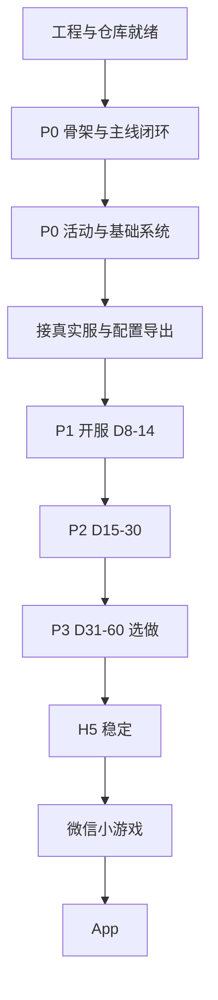

# mxzg 重做总规划与进度板

> **用途**：唯一进度真相源。每完成一个可勾选小目标，立刻改本文件（勾选 `[x]`、改「当前状态」、必要时补日期）。  
> **工程根目录**：`F:\project\mxzg`  
> **GitHub**：https://github.com/duqian53784-dotcom/mxzg  
> **负责人**：倩 · 协作助手：Grok Bot  
> **文档维护约定**：任何「做完了 / 推了 / 砍了」的变更，同一回合内更新本文件；不要另起平行清单。

---

## 0. 一句话目标

用 **Cocos Creator 3.8** 重做前端（**H5 优先**，再 App / 微信小游戏），约 **1 个月内**做到「可玩」——不是全量对等旧客户端，而是 **开服自然日前约 60 天体验**里优先可玩的内容（按分期 P0→P3 推进）。

---

## 1. 当前状态（每次有进展先改这里）

| 项 | 状态 | 备注 |
|----|------|------|
| 引擎 | ✅ 已定 | Cocos Creator **3.8.8**（本机已装） |
| 工程根 | ✅ 已建 | `F:\project\mxzg` = `client` + `config` + `server` |
| 客户端工程 | ✅ 空项目已就位 | Creator 打开 `F:\project\mxzg\client` |
| 远程仓库 | ✅ 已推送 | `main` 已含阶段 A–B 与 C1（`2cd4a5d`） |
| config 进 Git | ⏸ 暂不 | 本机 **junction** → `F:\mxzg-local` |
| server 进 Git | ⏸ 暂不 | 本机 **junction** → `F:\源码\mj\program\server` |
| 旧仓 / 旧客户端 | 📦 归档参考 | 旧代码在 `F:\源码\mj\program`；GitHub 旧大体积内容勿再整仓硬推 |
| 进度文档 | ✅ 本文 | `PROJECT_PLAN.md` |
| P0 可玩闭环 | ❌ 未开始 | 阶段 C 已开始：Mock 可选服、登录、创角后进主城。主城有顶栏（角色、等级、金币、钻石）和底栏；未解锁入口仍显示并 Toast。主线仍是假战斗；失败有中文 Toast；H5 安全区已接上 |
| 连真实服 | ❌ 未开始 | 协议 / 网关 / 登录 |
| 微信小游戏 | ❌ 未开始 | H5 稳定后再做 |
| App 包 | ❌ 未开始 | H5 之后 |

**当前焦点（唯一）：** C3 — 主线关卡（进战、战报或简化表现、结算、下一关）。

**上次更新：** 2026-10-20（Asia/Shanghai）— C2 完成：主城顶栏显示角色名、等级、金币和钻石；底栏是主城 / 英雄 / 召唤 / 铁匠铺 / 玩法。未解锁的按钮带「锁」，点击 Toast 条件（主线等级或开服天），不进入面板。面板沿用页面栈，可逐层返回。不改场景。

---

## 2. 产品与技术边界

### 2.1 要做什么

- 新客户端：TypeScript + Creator 3.8，优先 **Web Mobile（H5）**
- 复用现有 **Java 服务端** 与 **配置表**（不重写服为默认前提）
- 内容范围：按 **开服自然日** 切（`getOpenDays()`，开服当天 = 第 1 天），叠加系统入口多为 **主线等级** 解锁
- 一个月验收：能创角/登录（或本地假登录）→ 打主线 → 基础养成 → 至少一个核心玩法（如塔或竞技场）→ 七日目标类活动可跑通骨架

### 2.2 明确不做 / 后置（默认砍出 MVP）

- 全量迁移旧 Cocos2d-x + Lua + 全部 ccbi
- 神装系、讨伐团、跨服天梯、冥域（`*_days=9999`）等后期/高世界等级系统
- 运营位 `open_server_day=9999` 活动（竞技之巅、酒馆达标、合成觉醒、诸神之战、狂欢时刻）
- 一上来就做完整商业化深水、完整跨服、完整公会战

### 2.3 解锁口径（写代码时对照）

| 类型 | 来源 | 含义 |
|------|------|------|
| 开服自然日 | `ServerParamService.getOpenDays()` + `promotioncontrol.open_server_day` + `system.xlsx` 部分字段 | 活动轮次、幻魔塔 D30、公会战 D3 等 |
| 主线等级 | `opencondition.xlsx`（多为 `condition_type=1`） | 系统入口显示/可进 |
| 角色登录天 | 七天登录、30 日签到等 | 跟创角后登录天数，不是开服天 |
| 世界等级 | 少数系统（神装等） | MVP 默认不考虑 |

详细天数清单见：`C:\Users\Administrator\agent-tools\前60天-按开服自然日.md`（同源分析亦可拷进 `docs/`）。

---

## 3. 仓库与目录规划

```
F:\project\mxzg\
  client\          # Creator 3.8 工程 ← 日常打开这个
  config\          # junction → F:\mxzg-local（暂不进 Git）
  server\          # junction → F:\源码\mj\program\server（暂不进 Git）
  docs\            # 规划/分析文档
  PROJECT_PLAN.md  # 本文件（进度板）
  README.md
  .gitignore
```

### 3.1 Git 策略

- [x] 本地 `git init`，远程 `origin` = `https://github.com/duqian53784-dotcom/mxzg.git`
- [x] `.gitignore` 忽略 `client/library|temp|local|build|profiles` 与 `/config` `/server`
- [ ] 以后若 config/server 正式进仓：去掉 junction，放入真实内容或 submodule，并改 `.gitignore`
- [ ] 约定：小步提交；功能分支可选 `feat/p0-skeleton` 等，默认可直接 `main`（团队仅一人时）

### 3.2 本机路径速查

| 用途 | 路径 |
|------|------|
| 新工程根 | `F:\project\mxzg` |
| Creator 打开 | `F:\project\mxzg\client` |
| 配置表实体 | `F:\mxzg-local` |
| 旧服 / 旧客户端参考 | `F:\源码\mj\program` |
| Creator 编辑器 | `C:\ProgramData\cocos\editors\Creator\3.8.8\CocosCreator.exe` |

---

## 4. 总流程（宏观）



**原则：** 先垂直切片可玩，再横向加系统；活动日历按开服日，入口按等级。

---

## 5. 分期内容地图（开服自然日）

### 5.1 P0 · 开服 D1–D7（一个月可玩的主战场）

**玩法闭环**

- [ ] 创角 / 登录（可先假登录）
- [ ] 主线战斗 + 挂机收益展示
- [ ] 召唤
- [ ] 英雄基础养成（升级/升星/穿装至少一条）
- [ ] 背包 / 邮件 / 基础商店
- [ ] 铁匠铺（Lv5）
- [ ] 竞技场（Lv8）
- [ ] 许愿池低级（Lv10）
- [ ] 咖啡馆（Lv12）
- [ ] 幻境之塔（Lv16）
- [ ] 日常副本至少金币（Lv15）

**活动**

- [ ] 新号七天登录
- [ ] 七日目标（任务最高主线目标约 **70** → 主线必须能推到 70）
- [ ] 升级有礼、每日礼包/首充/累充骨架
- [ ] 限时兑换 / 点石成金 / 限时礼包（可简化 UI）

**可砍（P0）**

- 公会 / 公会战 / 世界 BOSS
- 跨服、通行证、锦鲤
- 商业化深水

### 5.2 P1 · 开服 D8–D14

- [ ] 三日任务
- [ ] 速战之王（可简化）
- [ ] 冒险笔记（可简化）
- [ ] 皮肤商城（可选）
- [ ] 公会 + 世界 BOSS / 公会战（若要社交）
- [ ] 祭坛、先知之树、英雄/羁绊副本

### 5.3 P2 · 开服 D15–D30

- [ ] 试炼之路、神秘魔盒
- [ ] 勇者试炼、高级许愿池、时光神殿置换
- [ ] **幻魔塔**（`magic_tower_open_day=30`）
- [ ] 通行证（若要做）

### 5.4 P3 · 开服 D31–D60

- [ ] 酒馆常客；精灵周卡（可砍）
- [ ] 月神庇护所、远古战场、精灵副本（Lv50–60）
- [ ] 超值赠礼等商业化
- [ ] 默认仍不做：艾尼亚战场/战役、跨服天梯、神装、讨伐团、冥域

---

## 6. 执行清单（越细越好 · 打勾即进度）

### 阶段 A · 工程基建（已完成）

- [x] A1 安装 Creator 3.8.8
- [x] A2 创建空 2D 项目并归位到 `F:\project\mxzg\client`
- [x] A3 根目录 `client` / `config` / `server` 布局
- [x] A4 config、server 本机 junction
- [x] A5 Git 初始化并 force push 到 `duqian53784-dotcom/mxzg`
- [x] A6 清理残留 `mxzg-client` 目录
- [x] A7 写入本规划 `PROJECT_PLAN.md`
- [x] A8 将「前60天-按开服自然日」拷贝到 `docs/day60-open-server.md`
- [x] A9 Creator 构建目标确认：场景已建；Web 桌面端构建通过（H5 验证完成，Web Mobile 可后续补）
- [x] A10 约定 `client` 内目录规范并建空目录（见 A10 明细）

**A10 建议目录（建好后勾选子项）**

```
client/assets/
  scripts/
    core/           # 入口、单例、事件总线
    net/            # 网络、协议编解码占位
    config/         # 读表
    module/         # 按系统分模块
    ui/             # UI 框架、弹窗、红点
  bundles/          # 远程/分包预留
  resources/        # 常驻资源
  scenes/
    Boot.scene
    Main.scene
    Battle.scene
```

- [x] A10.1 `scripts/core`（含 Boot.ts 占位）
- [x] A10.2 `scripts/net`（含 NetClient.ts 占位）
- [x] A10.3 `scripts/config`
- [x] A10.4 `scripts/module`
- [x] A10.5 `scripts/ui`（含 MainApp.ts 占位）
- [x] A10.6 `scenes/Boot|Main|Battle` 已在 Creator 内创建

### 阶段 B · P0 技术骨架（已完成）

- [x] B1 启动流程：Boot → 热更/版本检查占位 → 登录场景
- [x] B2 UI 框架：一层 Canvas、页面栈、弹窗队列、Toast
- [x] B3 配置加载：先支持 JSON（从 config 导出的精简表）；xlsx 导表流程文档化
- [x] B4 网络层占位：连接状态机、心跳、断线重连、消息派发（可先 Mock）
- [x] B5 协议：梳理旧 Protobuf 列表；P0 只用到的先生成/手写 stub（旧 .proto 不在本仓；手写 stub 见 `docs/protocol-stubs.md`）
- [x] B6 本地 Mock 服或录包回放（无真实服前可玩）（进程内 MockGameSession + ReplayTransport，见 `docs/mock-replay.md`）
- [x] B7 日志与错误码展示（GameLog + 错误码中文 Toast + 主城「日志」）
- [x] B8 多分辨率 / 安全区（H5）（`SafeArea` 读可见区域与 `sys.getSafeAreaRect`，Boot / UIShell 留边；设计分辨率保持 720×1280，不改适配策略。见 `docs/safe-area.md`）

### 阶段 C · P0 玩法垂直切片

- [x] C1 账号登录 / 选服 / 创角（UI + 协议或 Mock）（登录面板：账号 / 密码占位 / 本地Mock·提审·正式占位；`Proto.login` + `roleEnter`，无角色或点「创角」再 `roleCreate`。上次账号、服务器写在 `mxzg.account` / `mxzg.serverId`。主城显示角色名和服务器。`skipLogin` 仍跳过面板）
- [x] C2 主城 / 主界面导航（按 `opencondition` 显隐）（顶栏：角色名、等级、金币、钻石，来自 Mock 会话。底栏五个入口。未开启不隐藏，显示「锁·」并 Toast 条件：主线等级，幻魔塔再加开服第 30 天。玩法页是其余系统的占位。铁匠铺 Lv5。面板用原来的页面栈打开和返回。不改场景。）
- [ ] C3 主线关卡：进战、战报或简化表现、结算、下一关
- [ ] C4 挂机：时长、收益预览、快速作战入口
- [ ] C5 英雄列表 + 详情 + 升级或升星一条养成线
- [ ] C6 召唤一次完整流程
- [ ] C7 背包与道具使用
- [ ] C8 邮件列表与领取
- [ ] C9 铁匠铺最小可用
- [ ] C10 竞技场最小可用（匹配可 Mock）
- [ ] C11 幻境之塔最小可用
- [ ] C12 日常副本（金币）最小可用
- [ ] C13 七日登录
- [ ] C14 七日目标（任务跳转 + 领奖）
- [ ] C15 主线可推进至约 70（配合七日目标）

### 阶段 D · 接真实环境

- [ ] D1 本机起 `server` 联调文档（对照旧《项目分析与启动指南》）
- [ ] D2 H5 连本地网关（WS→TCP 或现有方案对齐）
- [ ] D3 登录到进主城全真实协议
- [ ] D4 配置导出管线：xlsx → 客户端可用格式；只导出 P0 表白名单
- [ ] D5 与服约定开服时间，验证活动按自然日开关

### 阶段 E · P1 / P2 / P3

- [ ] E1 按第 5 节清单逐项开任务，每完成一项在第 5 节打勾并改第 1 节「当前焦点」
- [ ] E2 每期结束做一次「可玩性演示」记录（日期 + 能玩到哪）

### 阶段 F · 发行形态

- [ ] F1 H5 性能与加载（首包、分包）
- [ ] F2 微信小游戏适配
- [ ] F3 App（Android/iOS）构建与热更策略

---

## 7. 配置表工作流（规划）

1. **源真相**：`F:\mxzg-local`（经 `config\` 联接访问）  
2. **P0 表白名单（示例，实施时补全路径）**  
   - `opencondition` / `system` / `promotioncontrol`  
   - 七日目标 / 七天登录 / 主线关卡 / 英雄 / 召唤 / 道具  
3. **导出**：统一脚本导出 JSON（或沿用旧二进制 + 新客户端解析）  
4. **进包**：`client` 仅含当前分期需要的表；禁止一次拷全量  
5. **何时进 Git**：导表脚本 + 导出产物策略定后，再决定 `config` 是否取消 junction 入库  

- [x] 写出 `docs/config-pipeline.md`  
- [ ] 列出 P0 表文件名完整清单（起步名单已写在该文档，完整路径未对照本机表）  
- [x] 打通第一条「表 → 客户端读到」样例  

---

## 8. 服务端工作流（规划）

1. 默认 **不重写服**；新客户端适配现有协议  
2. 本机通过 `server\` junction 查阅与启动  
3. 联调顺序：登录 → 角色 → 主线 → 背包 → 单系统  
4. 协议变更需极小且双边同步；能客户端兼容就不改服  

- [ ] `docs/server-local-run.md`（如何起服、端口、依赖）  
- [ ] P0 协议 ID / 消息名清单（B5 已有手写占位 `docs/protocol-stubs.md`；与旧 .proto 对齐后再勾）  

---

## 9. 协作与更新规则（强制）

1. **开干前**：看第 1 节「当前焦点」+ 对应阶段未勾项。  
2. **做完一小项**：立刻 `[x]`，必要时改第 1 节表格与「上次更新」。  
3. **砍需求 / 延期**：在对应项后写 `（延期：原因）` 或移到「不做」。  
4. **不要**另建第二份总进度表；细分任务可开 issue，但总状态以本文为准。  
5. Grok Bot 每次交付功能或确认完成时，**必须同步更新本文**。  

---

## 10. 风险与依赖

| 风险 | 影响 | 缓解 |
|------|------|------|
| 七日目标要求主线约 70 | P0 工作量被关卡/数值拖住 | 早期可调低目标或做「关卡跳关调试」 |
| 协议/网关复杂 | 接真服延期 | Mock 先行，保证垂直可玩 |
| 配置格式未知成本 | 读表慢 | 先 JSON 精简导出 |
| 旧资源（美术/特效）迁移 | 表现差或工期爆 | MVP 用占位图 + 少量关键spine/图集 |
| 误把 server/config 整仓推 Git | 仓库膨胀 | 保持 `.gitignore`；推送前 `git status` |

---

## 11. 里程碑（建议日历 · 可改）

| 里程碑 | 目标日（建议） | 完成判据 | 实际完成 |
|--------|----------------|----------|----------|
| M0 工程可预览 | 第 1 周内 | Web Mobile 空场景 + 目录规范 | |
| M1 Mock 可玩主线 | 第 2 周末 | 假登录→主线战斗→结算 | |
| M2 P0 系统最小集 | 第 3 周末 | 召唤+养成+塔或竞技场+七日登录 | |
| M3 真服联调 | 第 4 周 | 登录到主城真实协议 | |
| M4 可玩验收 | ~1 个月 | 倩认可的「能玩」演示 | |

---

## 12. 变更日志

| 日期 | 变更 |
|------|------|
| 2026-10-20 | 首版：目标、目录、P0–P3、阶段 A–F、维护约定；记录仓库已推送 |
| 2026-10-20 | A10：创建 scripts/scenes 目录与 Boot/NetClient/MainApp 占位；焦点改为 A9 |
| 2026-10-20 | A9/A10.6：Boot/Main/Battle 场景 + 启动场景 Boot + Web 桌面端构建通过；焦点改为 B1–B4 |
| 2026-10-20（Asia/Shanghai） | B1–B4：Boot 分阶段启动 + Mock 登录进 Main；UI 页面栈/弹窗队列/Toast；resources JSON 读表样例；NetClient 状态机与 MockTransport。焦点改为 B5 |
| 2026-10-20（Asia/Shanghai） | B5：P0 手写协议 stub（`Proto.login` / `roleEnter` / `roleCreate` / `stageEnter` / `stageResult` / `heartbeat`），MockTransport 补创角与主线进关/结算。焦点改为 B6 |
| 2026-10-20（Asia/Shanghai） | B6：MockGameSession 记住开服天 / 等级 / 主线进度；录包 `resources/mock/session-login-stage.json` + ReplayTransport。主城「主线」可假战斗结算。焦点改为 B7 |
| 2026-10-20（Asia/Shanghai） | B7：GameLog（级别、环形缓冲、`[mxzg]` 镜像）；错误码表；失败 Toast；主城「日志」面板。焦点改为 B8 |
| 2026-10-20（Asia/Shanghai） | B8：H5 安全区 / 多分辨率。设计分辨率保持 720×1280，代码不改 Fit Width / Fit Height。焦点改为 C1 |
| 2026-10-20（Asia/Shanghai） | C1：账号登录、选服（本地Mock / 提审 / 正式占位）、创角。上次账号和服务器记在本地。主城显示角色名和服务器。焦点改为 C2 |
| 2026-10-20（Asia/Shanghai） | C2：主城顶栏 / 底栏 / 面板返回栈。入口按 opencondition（主线等级）和 system_gate（幻魔塔开服天）上锁，点击 Toast。金币钻石记在 Mock 会话。焦点改为 C3 |

---

## 13. 下一步（写给下一回合的自己）

1. 推进 **C3**：主线关卡。进战、战报或简化表现、结算、下一关。C2 的主城「主线」仍是立刻胜利结算，没有战斗画面。  
2. C2 预览：见 `client/assets/scripts/README.md` 的 C2 一节。不需要在 Creator 里新挂组件或改场景；C1 已经挂过 Boot 的话，直接预览即可。  
3. 每完成一项，更新第 1 节与本清单。  
4. 有空时补一次 Web Mobile 构建（非阻塞）。对照旧 `.proto` 的真实消息号留到阶段 D，不要在 C3 做。安全区说明仍在 `docs/safe-area.md`。  