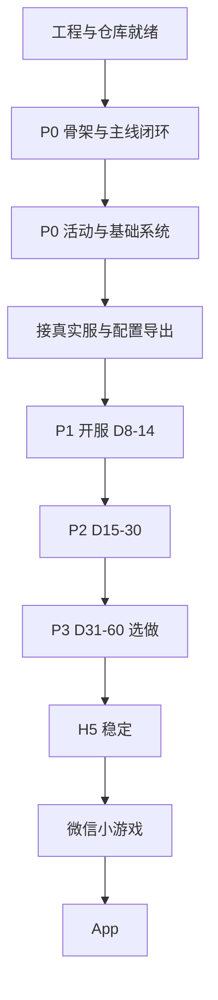

# mxzg 重做总规划与进度板

> **用途**：唯一进度真相源。每完成一个可勾选小目标，立刻改本文件（勾选 `[x]`、改「当前状态」、必要时补日期）。  
> **工程根目录**：`F:\project\mxzg`  
> **GitHub**：https://github.com/duqian53784-dotcom/mxzg  
> **负责人**：倩 · 协作助手：Grok Bot  
> **文档维护约定**：任何「做完了 / 推了 / 砍了」的变更，同一回合内更新本文件；不要另起平行清单。

---

## 0. 一句话目标

用 **Cocos Creator 3.8** 重做前端（**H5 优先**，再 App / 微信小游戏），约 **1 个月内**做到「可玩」——不是全量对等旧客户端，而是 **开服自然日前约 60 天体验**里优先可玩的内容（按分期 P0→P3 推进）。

---

## 1. 当前状态（每次有进展先改这里）

| 项 | 状态 | 备注 |
|----|------|------|
| 引擎 | ✅ 已定 | Cocos Creator **3.8.8**（本机已装） |
| 工程根 | ✅ 已建 | `F:\project\mxzg` = `client` + `config` + `server` |
| 客户端工程 | ✅ 空项目已就位 | Creator 打开 `F:\project\mxzg\client` |
| 远程仓库 | ✅ 已推送 | `main` 已含阶段 A–B、C1–C15、基础商店、许愿池低级、咖啡馆与礼包骨架（`d196d98`）。限时活动随本变更进入 |
| config 进 Git | ⏸ 暂不 | 本机 **junction** → `F:\mxzg-local` |
| server 进 Git | ⏸ 暂不 | 本机 **junction** → `F:\源码\mj\program\server` |
| 旧仓 / 旧客户端 | 📦 归档参考 | 旧代码在 `F:\源码\mj\program`；GitHub 旧大体积内容勿再整仓硬推 |
| 进度文档 | ✅ 本文 | `PROJECT_PLAN.md` |
| P0 Prefab | ✅ 已验收并接 USE_*_PREFAB | Login、CreateRole、CityChrome 三个 flag 默认 true。改 false 回代码搭 UI，不删 `buildLoginPanel` / `buildCreateRolePanel` / `mountCityChrome`。见 `docs/prefab-layout.md` |
| P0 可玩闭环 | 🟡 切片已可玩 | 阶段 C 的 C1–C15 已可玩。§5.1 勾选清单里的玩法闭环和活动 Mock 骨架已齐。不在勾选清单里、仍未做的有：英雄升星、经验副本、英雄副本、高级许愿池、30 日签到。基础商店已可买。许愿池低级已可许。咖啡馆已可招待。主城和玩法都能进「礼包」：升级有礼按主线 Lv5/10/15 各领一次，每日礼包花 10 钻石且随开服天刷新，首充点「模拟充值」只完成一次并发钻石和道具，累充按模拟金额领 6/30/68 档。已领取、等级不够或钻石不足会 Toast。不走真实支付。阶段 C 已开始：Mock 可选服、登录、创角后进主城。主城有顶栏（角色、等级、金币、钻石）和底栏；未解锁入口仍显示并 Toast。主线可进关卡列表、看简化战报、结算后下一关或回城；失败有中文 Toast。挂机可看时长和收益，领取后顶栏金币增加；快速作战一键结算当前关。底栏「英雄」可进列表和详情，升级扣金币并刷新顶栏，不足或满级会 Toast。底栏「召唤」可单抽或十连，扣钻石；新英雄进名册，重复转碎片，钻石不足会 Toast。主城和玩法都能进背包：强化石、英雄碎片、小金币袋和经验药水。使用消耗品会改金币或领队等级并 Toast，材料和碎片不能直接使用。主城和玩法都能进邮件：系统欢迎、开服补给和一条已读公告。领取附件后顶栏金币增加，道具进背包；已领取或没有附件会 Toast。底栏「铁匠铺」仍是主线 Lv5，未到只 Toast。到了之后可以强化英雄的新手短剑，消耗金币和强化石；不足会 Toast，成功后顶栏金币和英雄攻击跟着变。玩法里的「竞技场」仍是主线 Lv8，未到只 Toast。到了之后能看积分和约排名、一份固定对手，挑战一键结算。胜利加积分和金币，失败扣积分。每天 5 次，用完会 Toast。玩法里的「幻境之塔」仍是主线 Lv16，未到只 Toast。这不是幻魔塔。到了之后能看当前层，挑战一键结算。胜利进入下一层并获得金币和强化石，失败层数不变。每天 10 次，用完会 Toast。玩法里的「日常副本」仍是主线 Lv15，未到只 Toast。到了之后是金币副本：看剩余次数和难度奖励，挑战一键结算。胜利加金币，普通和困难再加强化石；失败不发奖励。每天 2 次，用完会 Toast。经验副本和英雄副本还没有。主城和玩法都能进七日登录，新号第 1 天可领。七天格子按角色登录天，不看开服天。领取把金币、钻石写入顶栏，道具写入背包。已领取或未到的天数会 Toast。页面上可以调试把登录天加到第 7 天。主城和玩法都能进七日目标。任务按当前通关、召唤、英雄升级和挂机领取显示进度，可以前往对应界面。完成可领金币、钻石或道具；没完成会 Toast。第 7 日通关第 70 关在到关之前保持未开启。主线列表和挂机都有「推关到70（调试）」，一次连胜到第 70 关，每关仍是金币 +10；一关关挑战和单次快速作战还在，70 关之后也能继续打。到 70 后第 7 日变为可领取。主城和玩法都能进基础商店，样例 opencondition 没有商店行，新号即可进。货架有强化石、小金币袋和经验药水，用金币或钻石购买，道具进背包，顶栏刷新。不够钱或今日售罄会 Toast。限购随开服天刷新。召唤仍直接花钻石。玩法里的「许愿池」仍是主线 Lv10，未到只 Toast。9 胜或 9 次快速作战到达。到了之后是低级许愿：花金币、许愿符或钻石许愿一次，奖池按固定顺序给金币、强化石、经验药水，第 10 次给钻石。每天 5 次，用完会 Toast。成功后顶栏和背包刷新。高级许愿池还没有。玩法里的「咖啡馆」仍是主线 Lv12，未到只 Toast。11 胜或 11 次快速作战到达。到了之后选出 1 到 2 名英雄派出招待，立刻可领。领取给金币和咖啡豆，顶栏和背包刷新。没选英雄、正在招待或今日次数用完会 Toast。主城和玩法都能进「限时活动」，页内分限时兑换、点石成金、限时礼包。兑换花咖啡豆或金币，点石每天第一次免费、之后花钻石换金币，限时礼包开服第 1 到 7 天可买且每种库存 1。不够、兑完、次数用完、已经购买或本轮结束会 Toast。不走真实支付。H5 安全区已接上 |
| 连真实服 | 🟡 D2 已验证 / D3 进行中 | D1：11122、9902、13101 在听（`docs/server-local-run.md`）。D2：倩本机已验证 `?transport=ws` + 桥 13111 → TCP 9902，GameLog 有 `收到 s2c 1001`（例：角色 1000002）及后续真服推送。默认仍 Mock。不直连 13101。D3：有角色会离开登录面板，进同一套主城壳。进主城后发空 c2s 2001。s2c 2001 按 Role.proto 写顶栏：字段 9 昵称、字段 6 等级、字段 2 金币、字段 1 宝石（钻石）。日志三例是「见习冒险家 Lv1」、金币 0、钻石 0；奖杯字段 5=1000 不进金币。缺字段仍是未同步。开服天仍未同步。进主城后紧接着发空 c2s 3007，再发空 c2s 3004。s2c 3007 按 Battle.proto 写主城「主线」按钮：字段 2 now_idx 为当前，字段 3 max_idx 为最高。net-20261020 三例没有字段 2、字段 3 是 0，按钮是「主线 · 最高 0」。不写 Mock 的「第 N 关」。至少有一个 idx（含 max_idx=0）时，点按钮打开代码页「主线（真服只读）」，显示当前 idx 和最高 idx，缺的写「未同步」，并写「本轮不发进关协议，不挑战」。两个 idx 都没有时仍 Toast，不打开页。不发 3002 / 3010，不打开 Mock 关卡页，不挑战、不结算。本刀已合，D3 仍不勾。P0 Prefab 已验收并接 USE_*_PREFAB。s2c 3004 记下上次领取时间（字段 1）和最大挂机时间（字段 2）。主城「挂机」没有这两项时 Toast「真服挂机未同步」，有则代码页展示时长；奖励清单不在这包里，不写金币。领取发空 c2s 3005，只记回包，不改钱包。进主城在空 c2s 2001 之后、空 c2s 3007 之前发空 c2s 5001（整帧 `04 00 00 00 89 13 00 00`）。不改 Boot.ts：`pullRoleProfile` 连发 2001 和 5001，已合的 2001 → 3007 → 3004 相对顺序不变。s2c 5001 空包体是已同步的空背包，代码页「背包（真服只读）」写「空背包」，不 Toast。有格子则只读写出 item_id、item_type、num，没有的数不写成 0。从未收到 5001 时主城和玩法的背包 Toast「真服未同步」，不打开 Mock 背包。s2c 5002 把 num 合并进本地列表，0 删掉该格，type 只打日志，不弹窗，不写顶栏。不发 5004–5009、5010、5011–5013。占位 bag.list / bag.use 仍是 1601 / 1602。日志没有非空 5001 样本，按 proto 解。本刀已合，D3 仍不勾。进主城在空 c2s 3004 之后发空 c2s 15000（整帧 `04 00 00 00 98 3a 00 00`）。不改 Boot.ts：`pullIdle` 先发 3004 再发 15000，已合的 2001 → 5001 → 3007 → 3004 相对顺序不变。s2c 15000 空包体是已同步的空邮箱，代码页「邮件（真服只读）」写「空邮箱」。有信则只读列出标题和有无附件。字段 3、字段 4 只记日志，不写成已读或未读。从未收到 15000 时主城和玩法的邮件 Toast「真服邮件未同步」，不打开 Mock 邮件。不领取，不删除，不写顶栏。占位 mail.list 到 mail.delete 仍是 1701–1705。仓库没有 Mail.proto。net-20261020 两例是带标题和附件的 292 字节，没有空包样本。本刀已合，D3 仍不勾。进主城在空 c2s 15000 之后发 c2s 4001（GReqHeroList.page=1，整帧 `06 00 00 00 a1 0f 00 00 08 01`）。禁止空体 `04 00 00 00 a1 0f 00 00`。不改 Boot.ts，`pullIdle` 在 15000 之后用 4001 替换原 18001，相对顺序是 2001 → 5001 → 3007 → 3004 → 15000 → 4001 → 17000 → 12010 → 18001。18001 是竞技场只读，接在 12010 之后，不是英雄。不发 20001。s2c 4001 是 GResHeroList：容量、购买次数、repeated ResHeroData、send_status、page。send_status=0 再发下一页，1 收齐。空名册是 list 长度为 0 的这一包，不是空体。列表写类型号（CHeroType.note 对上才用备注）、id、等级、星级和战力。不升级，不写金币。从未收到 4001 时 Toast「真服英雄未同步」，不打开 Mock 英雄。占位 hero.list / hero.upgrade 仍是 1401 / 1402。本刀已合，D3 仍不勾。c2s 4001 之后再发空 c2s 17000，再发空 c2s 12010。17000 是点金 GResBuyGoldLog，页「点金（真服只读）」，不绑七日登录，不点金，不写金币。12010 是成就 GResAchievementList，行上写 idx / process / state，空表写「空成就表」，页面写「打开/同步可能在服上补成就」。不发 12020。空 c2s 12010 之后再发空 c2s 18001（整帧 `04 00 00 00 51 46 00 00`）。玩法「竞技场」打开「竞技场（真服只读）」，空 list 写「空对手表」。不发 18002，不挑战，不写金币。空 c2s 18001 之后再发空 c2s 22000（整帧 `04 00 00 00 f0 55 00 00`，GReqSevenDayLoginData）。「七日登录」打开「七日登录（真服只读）」，写 end_time / cur_day / idx / status。不发 22001，不写金币。22000 无写库。空 c2s 22000 之后再发空 c2s 21010（整帧 `04 00 00 00 12 52 00 00`，即 `0400000012520000`，不要写成 `0400000002520000`）。「七日目标」打开「七日目标（真服只读）」，写 curr_day / seven_day_value / reward_box_idx / idx / process / state。不发 21011、21012。21013 只收。可能建档并懒填计数，不发奖。D3 仍不勾。全量协议还没接，D3 不勾。日常可双击 `scripts/start-local-all.bat` |
| 微信小游戏 | ❌ 未开始 | H5 稳定后再做 |
| App 包 | ❌ 未开始 | H5 之后 |

**当前焦点（唯一）：** 阶段 D3：真服登录进主城后，顶栏从 s2c 2001 同步昵称（字段 9）、等级（字段 6）、金币（字段 2）、钻石（字段 1 宝石）。进主城仍发空的 c2s 2001，紧接着发空的 c2s 3007。缺字段的格子保持未同步。字段 5 是奖杯，不进金币。开服天不从字段 16 的 unix 时间推。主城「主线」按钮从 s2c 3007 的 now_idx（字段 2，当前）和 max_idx（字段 3，最高）来；日志三例没有字段 2、字段 3 是 0，按钮是「主线 · 最高 0」。不写成 Mock 的「第 N 关」。至少有一个 idx（含 max_idx=0）时，点按钮打开代码页「主线（真服只读）」：当前 idx、最高 idx，缺的写「未同步」，并写「本轮不发进关协议，不挑战」。两个都没有仍 Toast，不打开页。不发 3002 / 3010，不打开 Mock 关卡页，不挑战、不结算。本刀已合。P0 Prefab 已验收并接 USE_*_PREFAB。空 c2s 3007 之后再发空 c2s 3004。s2c 3004 的字段 1、字段 2 给挂机页。没有这两项时主城「挂机」Toast「真服挂机未同步」，不打开 Mock 挂机。有数据则展示已挂机时长；这一包没有奖励清单，不按 Mock 每分钟金币写预览。点领取发空 c2s 3005，只记 reward_time，不改金币。不拿 Mock 钱包冒充。空 c2s 2001 之后、空 c2s 3007 之前再发空 c2s 5001。不改 Boot.ts。s2c 5001 空包体打开代码页「背包（真服只读）」并写「空背包」；有格子写出 item_id、item_type、num，没有的数不写成 0；从未收到则 Toast「真服未同步」，不打开 Mock 背包。s2c 5002 合并数量，type 只记日志，不写顶栏。不发 5004–5009、5010、5011–5013。占位 bag.list / bag.use 仍是 1601 / 1602。本刀已合，D3 仍不勾。空 c2s 3004 之后再发空 c2s 15000。不改 Boot.ts。s2c 15000 空包体打开代码页「邮件（真服只读）」并写「空邮箱」；有信列出标题和有无附件；从未收到则 Toast「真服邮件未同步」，不打开 Mock 邮件。字段 3、字段 4 只记日志。不领取，不删除，不写顶栏。占位 mail.list 到 mail.delete 仍是 1701–1705。本刀已合，D3 仍不勾。进主城在空 c2s 15000 之后发 c2s 4001（GReqHeroList.page=1，整帧 `06 00 00 00 a1 0f 00 00 08 01`）。禁止空体 `04 00 00 00 a1 0f 00 00`。不改 Boot.ts，`pullIdle` 在 15000 之后用 4001 替换原 18001，相对顺序是 2001 → 5001 → 3007 → 3004 → 15000 → 4001 → 17000 → 12010 → 18001。18001 是竞技场只读，接在 12010 之后，不是英雄。不发 20001。s2c 4001 是 GResHeroList：容量、购买次数、repeated ResHeroData、send_status、page。send_status=0 再发下一页，1 收齐。空名册是 list 长度为 0 的这一包，不是空体。列表写类型号（CHeroType.note 对上才用备注）、id、等级、星级和战力。不升级，不写金币。从未收到 4001 时 Toast「真服英雄未同步」，不打开 Mock 英雄。占位 hero.list / hero.upgrade 仍是 1401 / 1402。c2s 4001 之后再发空 c2s 17000（整帧 `04 00 00 00 68 42 00 00`）。不改 Boot.ts。相对顺序 2001 → 5001 → 3007 → 3004 → 15000 → 4001 → 17000 → 12010。s2c 17000 按 GResBuyGoldLog 打开「点金（真服只读）」：status、time 写原数，行上写 idx / num。空包体或没有 list 写「已同步空表」。主城按钮是「点金」。从未收到点「点金」Toast「真服未同步」。不点金，不写金币。「七日登录」不绑 17000。占位 login7.* 仍是 2201–2203。空 c2s 17000 之后再发空 c2s 12010（整帧 `04 00 00 00 ea 2e 00 00`）。不发 12020。s2c 12010 是 GResAchievementList，行上写 idx / process / state。空 list（含空包体）写「空成就表」。页面写「打开/同步可能在服上补成就」。服端 getRoleAllTask 会懒建首链成就并落库。不领奖，不改 state，不写金币。空 c2s 12010 之后再发空 c2s 18001（整帧 `04 00 00 00 51 46 00 00`）。不改 Boot.ts。相对顺序 2001 → 5001 → 3007 → 3004 → 15000 → 4001 → 17000 → 12010 → 18001。s2c 18001 按 GResPvpData 打开「竞技场（真服只读）」：free_count、score，对手写 player_id 和 name。空 list 写「空对手表」。页面写「同步时若对手为空服可能补名单」。不发 18002、18003、18005、18007、18008。不挑战，不写金币。从未收到 Toast「真服未同步」，不回落 Mock。占位 arena.view / arena.challenge 仍是 1901 / 1902。空 c2s 18001 之后再发空 c2s 22000（整帧 `04 00 00 00 f0 55 00 00`，GReqSevenDayLoginData）。不改 Boot.ts。相对顺序 2001 → 5001 → 3007 → 3004 → 15000 → 4001 → 17000 → 12010 → 18001 → 22000 → 21010 → 27001 → 4004 → 13044 → 4101 → 4013 → 74100。s2c 22000 是 GResSevenDayLoginData：end_time、cur_day，行上写 idx / status。0 写未领，1 写已领。空领奖表仍是非空外层，不要当成未同步。页面「七日登录（真服只读）」写「22000 只读，无写库，无自动领奖」。不发 22001，不写金币。22002 是隔天推送，只改 cur_day，不是 c2s。从未收到 Toast「真服未同步」，不回落 Mock。占位 login7.* 仍是 2201–2203。不接 USE_*。空 c2s 22000 之后再发空 c2s 21010（整帧 `04 00 00 00 12 52 00 00`，即 `0400000012520000`）。相对顺序接到 21010。s2c 21010 是 GResSevenDayTargetList：curr_day、seven_day_value、reward_box_idx，行上写 idx / process / state。0 写未领，1 写已领。空表外层仍带 3 和 4。页面「七日目标（真服只读）」写「首次拉取可能建档，并懒填计数。不发奖」。不发 21011、21012。21013 只收。从未收到 Toast「真服未同步」，不回落 Mock。占位 goal7.* 仍是 2301 / 2302。不接 USE_*。D3 仍不勾。空 c2s 27001 之后再发空 c2s 4004（整帧 `04 00 00 00 a4 0f 00 00`，即 `04000000a40f0000`。没有 page）。不改 Boot.ts。s2c 4004 是 GResHeroSummonCount：free_time、senior_free_time。没有的数不写成 0。底栏「召唤」打开「召唤（真服只读）」。可能懒建 HeroSummon，不写金币，不写钻石。不发 4002、4005。不做 58001、58007、4201。英雄列表仍是 4001。从未收到 Toast「真服未同步」，不回落 Mock。占位 summon.pull 仍是 1501。不接 USE_*。D3 仍不勾。空 c2s 4004 之后再发空 c2s 13044（整帧 `04 00 00 00 f4 32 00 00`，即 `04000000f4320000`，GReqProphetSummonInfo）。不改 Boot.ts。相对顺序接到 `… → 27001 → 4004 → 13044`。不发 13041、13042、13043。不做 58007、4201。s2c 13044 是 GResProphetSummonInfo：luckys 为 repeated PSProphetLucky，type、lucky。没有的数不写成 0。主城「先知召唤」打开「先知召唤（真服只读）」。可能懒建 HeroSummon，跨日可能重置 levelResetTimes，不写金币，不写钻石。从未收到 Toast「真服未同步」，不回落 Mock。召唤次数仍是 4004。不接 USE_*。D3 仍不勾。空 c2s 13044 之后再发空 c2s 4101（整帧 `04 00 00 00 05 10 00 00`，即 `0400000005100000`，GReqHeroJewel 空体）。不改 Boot.ts。相对顺序接到 `… → 4004 → 13044 → 4101`。不发 4102 替换、4103 卸、4104 一键穿、4105 一键卸、4106 合成、4107 一键合成。不做 9001。s2c 4101 是 GResHeroJewel：jewel_list 为 repeated PSHeroJewelData，hero_id，以及 PSJewelData 的 jewel_id、place、jewel_type。没有的数不写成 0。主城「英雄宝石」打开「英雄宝石（真服只读）」。无写库，无 page，空体安全，不写金币，不写钻石。从未收到 Toast「真服未同步」，不回落 Mock。英雄列表仍是 4001。先知召唤仍是 13044。不接 USE_*。D3 仍不勾。空 c2s 4101 之后再发空 c2s 4013（整帧 `04 00 00 00 ad 0f 00 00`，即 `04000000ad0f0000`，GReqIllustratReward 空体。名字像领奖，实为查看）。不改 Boot.ts。相对顺序接到 `… → 13044 → 4101 → 4013`。不发 4014。4014 仅 s2c 推送。不把 4013 当领奖再发写号。s2c 4013 是 GResIllustratReward：list 为 repeated ResIllustratRewardData，hero_type、star。没有的数不写成 0。主城「英雄图鉴」打开「英雄图鉴（真服只读）」。无档时服端可能懒建空记录，可接受。不写金币，不写钻石。从未收到 Toast「真服未同步」，不回落 Mock。英雄列表仍是 4001。英雄宝石仍是 4101。不接 USE_*。D3 仍不勾。空 c2s 4013 之后再发空 c2s 74100（整帧 `04 00 00 00 74 21 01 00`，即 `0400000074210100`，GReqPetInfoList 空体）。不改 Boot.ts。相对顺序接到 `… → 4101 → 4013 → 74100`。不发 74101 升级、74102 携带、74103 卸下。74105、74106 仅 s2c 推送，不主动发。s2c 74100 是 GResPetInfoList：list 为 repeated PSPetInfo，pet_id、sys_id、hero_id、level。没有的数不写成 0。主城「宠物信息」打开「宠物信息（真服只读）」。无写库。空 list 仍非空外层，可接受。不写金币，不写钻石。从未收到 Toast「真服未同步」，不回落 Mock。英雄列表仍是 4001。英雄图鉴仍是 4013。不接 USE_*。D3 仍不勾。空回包仍创角。其它玩法页先不打开。默认仍 Mock。不直连 13101。全量协议未接，D3 不勾。日常双击一次 `scripts/start-local-all.bat`；只拉了客户端就刷新预览。见 `docs/h5-websocket.md`。

**上次更新：** 2026-10-21（Asia/Shanghai）— 真服背包列表只读补字段解析。空 c2s 5001（整帧 `04 00 00 00 89 13 00 00`，即 `0400000089130000`，GReqBackPackList 空体）已在 `pullRoleProfile` 里、空 c2s 2001 之后发出，`pullIdle` 在 74100 之后不再补发。不改 Boot.ts。s2c 5001 是 GResBackPackList：list 为 repeated ResBackPackItem，item_id=1、item_type=2、num=3。没有的数不写成 0。出现的 0 仍写 0。无写库。只读 list。不写金币，不写钻石。主城和玩法的「背包」打开「背包（真服只读）」。从未收到 Toast「真服未同步」，不回落 Mock。不发 5004、5005 合成，不发 5006 开箱，不发 5008、5009 碎片自选，不发 5011 分解，不发 5012 充值卡。5002 仅推送，不主动发。不接 USE_*。D3 仍不勾。

---

## 2. 产品与技术边界

### 2.1 要做什么

- 新客户端：TypeScript + Creator 3.8，优先 **Web Mobile（H5）**
- 复用现有 **Java 服务端** 与 **配置表**（不重写服为默认前提）
- 内容范围：按 **开服自然日** 切（`getOpenDays()`，开服当天 = 第 1 天），叠加系统入口多为 **主线等级** 解锁
- 一个月验收：能创角/登录（或本地假登录）→ 打主线 → 基础养成 → 至少一个核心玩法（如塔或竞技场）→ 七日目标类活动可跑通骨架

### 2.2 明确不做 / 后置（默认砍出 MVP）

- 全量迁移旧 Cocos2d-x + Lua + 全部 ccbi
- 神装系、讨伐团、跨服天梯、冥域（`*_days=9999`）等后期/高世界等级系统
- 运营位 `open_server_day=9999` 活动（竞技之巅、酒馆达标、合成觉醒、诸神之战、狂欢时刻）
- 一上来就做完整商业化深水、完整跨服、完整公会战

### 2.3 解锁口径（写代码时对照）

| 类型 | 来源 | 含义 |
|------|------|------|
| 开服自然日 | `ServerParamService.getOpenDays()` + `promotioncontrol.open_server_day` + `system.xlsx` 部分字段 | 活动轮次、幻魔塔 D30、公会战 D3 等 |
| 主线等级 | `opencondition.xlsx`（多为 `condition_type=1`） | 系统入口显示/可进 |
| 角色登录天 | 七天登录、30 日签到等 | 跟创角后登录天数，不是开服天 |
| 世界等级 | 少数系统（神装等） | MVP 默认不考虑 |

详细天数清单见：`C:\Users\Administrator\agent-tools\前60天-按开服自然日.md`（同源分析亦可拷进 `docs/`）。

---

## 3. 仓库与目录规划

```
F:\project\mxzg\
  client\          # Creator 3.8 工程 ← 日常打开这个
  config\          # junction → F:\mxzg-local（暂不进 Git）
  server\          # junction → F:\源码\mj\program\server（暂不进 Git）
  docs\            # 规划/分析文档
  scripts\         # 日常双击 start-local-all.bat：游戏服 + 13111 桥。分拆仍是 start-local-server.bat / start-ws-bridge.bat
  PROJECT_PLAN.md  # 本文件（进度板）
  README.md
  .gitignore
```

### 3.1 Git 策略

- [x] 本地 `git init`，远程 `origin` = `https://github.com/duqian53784-dotcom/mxzg.git`
- [x] `.gitignore` 忽略 `client/library|temp|local|build|profiles` 与 `/config` `/server`
- [ ] 以后若 config/server 正式进仓：去掉 junction，放入真实内容或 submodule，并改 `.gitignore`
- [ ] 约定：小步提交；功能分支可选 `feat/p0-skeleton` 等，默认可直接 `main`（团队仅一人时）

### 3.2 本机路径速查

| 用途 | 路径 |
|------|------|
| 新工程根 | `F:\project\mxzg` |
| Creator 打开 | `F:\project\mxzg\client` |
| 配置表实体 | `F:\mxzg-local` |
| 旧服 / 旧客户端参考 | `F:\源码\mj\program` |
| Creator 编辑器 | `C:\ProgramData\cocos\editors\Creator\3.8.8\CocosCreator.exe` |

---

## 4. 总流程（宏观）



**原则：** 先垂直切片可玩，再横向加系统；活动日历按开服日，入口按等级。

---

## 5. 分期内容地图（开服自然日）

### 5.1 P0 · 开服 D1–D7（一个月可玩的主战场）

**玩法闭环**

- [x] 创角 / 登录（可先假登录）（C1）
- [x] 主线战斗 + 挂机收益展示（C3、C4；C15 可推到约 70，之后仍能继续打）
- [x] 召唤（C6）
- [x] 英雄基础养成（升级/升星/穿装至少一条）（C5 升级、C9 新手短剑强化；升星未做）
- [x] 背包 / 邮件 / 基础商店（背包 C7、邮件 C8；基础商店：主城和玩法可进，样例表无商店解锁行，新号用金币或钻石购买。限购随开服天刷新）
- [x] 铁匠铺（Lv5）（C9）
- [x] 竞技场（Lv8）（C10）
- [x] 许愿池低级（Lv10）（玩法列表进入。金币、许愿符或钻石许一次。奖池为金币、强化石、经验药水，第 10 次钻石。每天 5 次。9 胜或 9 次快速作战开锁。高级许愿池未做）
- [x] 咖啡馆（Lv12）（玩法列表进入。选出 1 到 2 名英雄派出招待，立刻领取。1 人金币 +60、咖啡豆 ×1，2 人金币 +100、咖啡豆 ×2。每天 3 次。11 胜或 11 次快速作战开锁。第 10 胜只到 Lv11）
- [x] 幻境之塔（Lv16）（C11）
- [x] 日常副本至少金币（Lv15）（C12。经验副本和英雄副本未做）

**活动**

- [x] 新号七天登录（C13）
- [x] 七日目标（任务最高主线目标约 **70** → 主线必须能推到 70）（C14 任务列表、跳转和领奖；C15 推到 70 后第 7 日可领）
- [x] 升级有礼、每日礼包/首充/累充骨架（合成一个「礼包」入口，主城和玩法都能进，不设等级锁。升级有礼按主线 Lv5/10/15 各领一次：Lv5 金币 +100、强化石 ×3，Lv10 钻石 +20、经验药水 ×1，Lv15 金币 +200、小金币袋 ×1。每日礼包花 10 钻石，得金币 +80、强化石 ×2，一天一次，随开服天刷新。首充「模拟充值」标记 firstChargeDone，发钻石 +60、经验药水 ×1，并计入累充 6。累充页再模拟一次 +30，达标领 6/30/68。已领取、等级不够或钻石不足 Toast。不是真实支付）
- [x] 限时兑换 / 点石成金 / 限时礼包（可简化 UI）（合成一个「限时活动」入口，主城和玩法都能进，不设等级锁。限时兑换：咖啡豆 ×2 换经验药水 ×1，今日 2 次；金币 50 换强化石 ×4，今日 3 次。点石成金：每天 3 次，第一次免费得金币 100，之后钻石 5 换金币 100。限时礼包：开服礼包花钻石 15，库存 1，得金币 +180、强化石 ×3；限时补给点「模拟购买」，库存 1，得钻石 +30、经验药水 ×1。开服第 1–7 天可买，倒计时按开服天。材料不够、售罄、次数用完、已经购买或本轮结束会 Toast。兑换和点石随开服天刷新。不是真实支付）

**可砍（P0）**

- 公会 / 公会战 / 世界 BOSS
- 跨服、通行证、锦鲤
- 商业化深水

### 5.2 P1 · 开服 D8–D14

- [ ] 三日任务
- [ ] 速战之王（可简化）
- [ ] 冒险笔记（可简化）
- [ ] 皮肤商城（可选）
- [ ] 公会 + 世界 BOSS / 公会战（若要社交）
- [ ] 祭坛、先知之树、英雄/羁绊副本

### 5.3 P2 · 开服 D15–D30

- [ ] 试炼之路、神秘魔盒
- [ ] 勇者试炼、高级许愿池、时光神殿置换
- [ ] **幻魔塔**（`magic_tower_open_day=30`）
- [ ] 通行证（若要做）

### 5.4 P3 · 开服 D31–D60

- [ ] 酒馆常客；精灵周卡（可砍）
- [ ] 月神庇护所、远古战场、精灵副本（Lv50–60）
- [ ] 超值赠礼等商业化
- [ ] 默认仍不做：艾尼亚战场/战役、跨服天梯、神装、讨伐团、冥域

---

## 6. 执行清单（越细越好 · 打勾即进度）

### 阶段 A · 工程基建（已完成）

- [x] A1 安装 Creator 3.8.8
- [x] A2 创建空 2D 项目并归位到 `F:\project\mxzg\client`
- [x] A3 根目录 `client` / `config` / `server` 布局
- [x] A4 config、server 本机 junction
- [x] A5 Git 初始化并 force push 到 `duqian53784-dotcom/mxzg`
- [x] A6 清理残留 `mxzg-client` 目录
- [x] A7 写入本规划 `PROJECT_PLAN.md`
- [x] A8 将「前60天-按开服自然日」拷贝到 `docs/day60-open-server.md`
- [x] A9 Creator 构建目标确认：场景已建；Web 桌面端构建通过（H5 验证完成，Web Mobile 可后续补）
- [x] A10 约定 `client` 内目录规范并建空目录（见 A10 明细）

**A10 建议目录（建好后勾选子项）**

```
client/assets/
  scripts/
    core/           # 入口、单例、事件总线
    net/            # 网络、协议编解码占位
    config/         # 读表
    module/         # 按系统分模块
    ui/             # UI 框架、弹窗、红点
  bundles/          # 远程/分包预留
  resources/        # 常驻资源
  scenes/
    Boot.scene
    Main.scene
    Battle.scene
```

- [x] A10.1 `scripts/core`（含 Boot.ts 占位）
- [x] A10.2 `scripts/net`（含 NetClient.ts 占位）
- [x] A10.3 `scripts/config`
- [x] A10.4 `scripts/module`
- [x] A10.5 `scripts/ui`（含 MainApp.ts 占位）
- [x] A10.6 `scenes/Boot|Main|Battle` 已在 Creator 内创建

### 阶段 B · P0 技术骨架（已完成）

- [x] B1 启动流程：Boot → 热更/版本检查占位 → 登录场景
- [x] B2 UI 框架：一层 Canvas、页面栈、弹窗队列、Toast
- [x] B3 配置加载：先支持 JSON（从 config 导出的精简表）；xlsx 导表流程文档化
- [x] B4 网络层占位：连接状态机、心跳、断线重连、消息派发（可先 Mock）
- [x] B5 协议：梳理旧 Protobuf 列表；P0 只用到的先生成/手写 stub（旧 .proto 不在本仓；手写 stub 见 `docs/protocol-stubs.md`）
- [x] B6 本地 Mock 服或录包回放（无真实服前可玩）（进程内 MockGameSession + ReplayTransport，见 `docs/mock-replay.md`）
- [x] B7 日志与错误码展示（GameLog + 错误码中文 Toast + 主城「日志」）
- [x] B8 多分辨率 / 安全区（H5）（`SafeArea` 读可见区域与 `sys.getSafeAreaRect`，Boot / UIShell 留边；设计分辨率保持 720×1280，不改适配策略。见 `docs/safe-area.md`）

### 阶段 C · P0 玩法垂直切片（C1–C15 已完成）

C1–C15 这条垂直切片做完了。§5.1 的基础商店、许愿池低级、咖啡馆和礼包骨架已做。限时兑换 / 点石成金 / 限时礼包还没做，不在这一条清单里。下一具体项是把这三项合成一个简化面板；若一轮做不完，只做限时礼包。

- [x] C1 账号登录 / 选服 / 创角（UI + 协议或 Mock）（登录面板：账号 / 密码占位 / 本地Mock·提审·正式占位；`Proto.login` + `roleEnter`，无角色或点「创角」再 `roleCreate`。上次账号、服务器写在 `mxzg.account` / `mxzg.serverId`。主城显示角色名和服务器。`skipLogin` 仍跳过面板）
- [x] C2 主城 / 主界面导航（按 `opencondition` 显隐）（顶栏：角色名、等级、金币、钻石，来自 Mock 会话。底栏五个入口。未开启不隐藏，显示「锁·」并 Toast 条件：主线等级，幻魔塔再加开服第 30 天。玩法页是其余系统的占位。铁匠铺 Lv5。面板用原来的页面栈打开和返回。不改场景。）
- [x] C3 主线关卡：进战、战报或简化表现、结算、下一关（主城「主线」进关卡列表。挑战当前关：`stage.enter` → 简化战报（占位单位、回合、可跳过）→ `stage.result`。结算显示胜负和奖励，可下一关、回列表或回主城。撤退判负，Toast「挑战失败，进度不变」，金币不加。当前关战报判胜，Mock 可连推到第 70 关。不加载 Battle.scene，不改协议号。）
- [x] C4 挂机：时长、收益预览、快速作战入口（主城「挂机」和玩法列表都能进，不设等级锁。时长从本局开始或上次领取起算，上限 8 小时。预览金币和强化石，按已通关关数计算。领取写入 Mock 会话并刷新顶栏。快速作战一键 `stage.enter` + `stage.result`，不播 C3 战报。不改场景。）
- [x] C5 英雄列表 + 详情 + 升级（底栏「英雄」打开列表。空名册会种下光耀骑士、林间游侠、星辉法师。详情显示名字、等级、星级和攻击/生命/防御占位。升级消耗金币，写入 Mock 会话，顶栏金币刷新。金币不足或已满级 Toast，不改等级。返回走原来的页面栈。不改场景。升星留到以后。）
- [x] C6 召唤一次完整流程（底栏「召唤」打开召唤页，不再是占位。单抽 10 钻石，十连 90 钻石。Mock 按固定顺序抽出：新英雄追加到名册（英雄页能看到），已拥有的转碎片记在会话里。成功 Toast，顶栏钻石刷新。钻石不足或次数不对只 Toast，名册和钱包不变。返回走原来的页面栈。不改场景。背包界面留到 C7。）
- [x] C7 背包与道具使用（主城「背包」和玩法列表都能进。`opencondition` 的背包是主线 Lv1，未开时仍显示并 Toast，和 C2 一样。列表含小金币袋、经验药水、挂机强化石、召唤重复碎片。点一项再使用：金币袋加金币并刷新顶栏，经验药水给名册第一名加经验并升级；强化石和碎片只 Toast「不能直接使用」，数量不变。空背包 Toast「背包是空的」，数量不够 Toast「数量不足」。返回走原来的页面栈。不改场景。）
- [x] C8 邮件列表与领取（主城「邮件」和玩法列表都能进。`opencondition` 的邮件是主线 Lv1，未开时仍显示并 Toast，和 C2 一样。邮箱有三封：未读的系统欢迎、未读的开服补给（金币、强化石、小金币袋）、已读的维护公告。列表显示未读或已读、标题、有没有附件。点开看正文和附件，未读变为已读。领取一封或全部领取把金币写入钱包、道具写入背包，并标成已领取。顶栏金币刷新，再进背包能看到强化石和小金币袋。已领取或没有附件会 Toast。未领附件不能删除。返回走原来的页面栈。不改场景。）
- [x] C9 铁匠铺最小可用（底栏「铁匠铺」仍是主线 Lv5，未开只 Toast。打开后强化英雄的新手短剑：消耗金币和强化石，攻击提高。强化石来自挂机或邮件，背包里不能直接使用。不足或满级 Toast，不改等级。成功后顶栏金币刷新，英雄详情能看到武器和更高的攻击。没有武器时，创角或第一次打开补 Lv1，不扣费。返回走原来的页面栈。不改场景。主线打赢 4 关，或挂机快速作战 4 次，等级到 Lv5。）
- [x] C10 竞技场最小可用（匹配可 Mock）（玩法列表「竞技场」仍是主线 Lv8，未开只 Toast。打开后显示积分、约排名、战力和一份固定对手。挑战一键结算，不播战报。战力不低于对手则胜，积分上升并加金币；否则积分下降，金币不变。每天 5 次，用完 Toast。次数跟着 Mock 开服天重置，创角把积分和次数重置。不改主线、英雄和钻石。返回走原来的页面栈。不改场景。主线打赢 7 关，或挂机快速作战 7 次，等级到 Lv8。）
- [x] C11 幻境之塔最小可用（玩法列表「幻境之塔」仍是主线 Lv16，未开只 Toast。条件是 `opencondition` 的 `main_fantasy_tower`，不看开服天。幻魔塔仍要开服第 30 天，不要混。打开后看当前层和守关战力，挑战一键结算，不播战报。战力不低于守关则胜，层数 +1，金币和强化石进账；失败层数不变并 Toast。每天 10 次，用完 Toast。通关第 20 层后提示已到塔顶。15 胜或 15 次快速作战到 Lv16。不改场景。）
- [x] C12 日常副本（金币）最小可用（玩法列表「日常副本」仍是主线 Lv15，未开只 Toast。条件是 `opencondition` 的 `main_mission`，不看开服天。打开后是金币副本：今日剩余次数，以及简单 / 普通 / 困难三档的金币预览。挑战一键结算，不播战报。战力不低于该档则发金币，普通和困难再发强化石；失败不发奖励，仍占 1 次。每天 2 次，用完 Toast。次数跟着 Mock 开服天重置，创角清零。不改主线、英雄、钻石、竞技场和幻境之塔。返回走原来的页面栈。不改场景。经验副本和英雄副本留到以后。主线打赢 14 关，或挂机快速作战 14 次，等级到 Lv15。第 13 胜只到 Lv14，仍然上锁。）
- [x] C13 七日登录（主城和玩法都能进，新号第 1 天可领。七格按角色登录天，不看开服天。奖励混有金币、钻石、强化石、小金币袋和经验药水。领取写入钱包和背包并 Toast，顶栏刷新。已领取 Toast「已经领取」，未到的天 Toast「尚未到达」，格子标已领取 / 今日可领 / 可补领 / 未到达。已到达但没领的可以补领。页面「下一天（调试）」把角色登录天 +1，最多第 7 天，不改开服天，不自动领。创角回到第 1 天并清掉已领记录。返回走原来的页面栈。不改场景。）
- [x] C14 七日目标（任务跳转 + 领奖）（主城和玩法都能进，按钮在七日登录旁边。不设等级锁。按天列出骨架任务，进度读当前会话：已通关、召唤卡数、英雄高出 Lv1 的等级、成功领取挂机的次数。早期任务是通关第 1/3/5 关、召唤 1 次、升级英雄 1 次、领取挂机 1 次。完成点「领取」发金币、钻石或道具并 Toast，顶栏刷新；没完成、已领取、没有这个目标会 Toast。第 5、6 天还没有任务。「前往」用原来的页面栈再压一层：主线、召唤、英雄或挂机，返回回到目标页。第 7 日「通关主线第 70 关」在 `clearedStage` 到 70 之前是未开启，到了变成可领取。这是 C15 的钩子。天数不锁任务。创角清掉已领记录和挂机领取次数。不改场景。）
- [x] C15 主线可推进至约 70（配合七日目标）（主线关卡列表和挂机页都有「推关到70（调试）」。一次连胜推到第 70 关，不播战报。每一关仍是金币 +10，和一关关打、单次快速作战相同。等级 = 1 + 已通关，开服天仍是至少每 5 关 +1，只升不降，不改角色登录天。已经到了再点只 Toast，不加金币。一关关挑战和单次快速作战还在，第 70 关之后也能继续打。推到 70 后七日目标第 7 日「通关主线第70关」变为可领取，领取逻辑不改。不改场景。）

### 阶段 D · 接真实环境

- [x] D1 本机起 `server` 联调文档（对照旧《项目分析与启动指南》）（`docs/server-local-run.md` 可执行步骤 + `scripts/start-local-server.bat`。2026-10-21 倩本机验证：11122、9902、13101 在听。cross 默认不启，11422 噪声预期）
- [x] D2 H5 连本地网关（WS→TCP 或现有方案对齐）（倩本机已验证：`?transport=ws` + bridge 13111 → TCP 9902，GameLog 有 `收到 s2c 1001`（例：角色 1000002）及后续真服推送；默认仍 Mock；不直连 13101。见 `docs/h5-websocket.md`）
- [ ] D3 登录到进主城全真实协议（有角色的 s2c 1001 会离开登录面板，进同一套主城壳。进主城后发空的 c2s 2001。s2c 2001 按 Role.proto 的 GResRoleInfo 写顶栏：字段 9 昵称、字段 6 等级、字段 2 金币、字段 1 宝石（钻石）。net-20261020 conn `d6108a92` 包体 `08 00 10 00 … 28 e8 07 30 01 … 4a 0f …` 解开是钻石 0、金币 0、奖杯 1000、等级 1、昵称「见习冒险家」。字段 5 不进金币。缺字段的格子仍是未同步，回包前不显示占位 Lv1，不把 Mock 钱包当真进度。字段 16 的开服 unix 秒不推开服天。进主城后紧接着发空的 c2s 3007（整帧 `04 00 00 00 bf 0b 00 00`，日志三例都在 s2c 2001 之后的同步里，夹在 58017 和 3004 中间）。s2c 3007 按 Battle.proto 的 GResChapterData 写主城「主线」按钮：字段 2 now_idx 为当前，字段 3 max_idx 为最高。三例包体 `08 … 18 00` 没有字段 2、字段 3 是 0，按钮是「主线 · 最高 0」。缺的 idx 不写成 0。不写 `Session.stageId`。至少有一个 idx（含 max_idx=0）时点按钮打开代码页「主线（真服只读）」：当前 idx、最高 idx，缺的写「未同步」，并写「本轮不发进关协议，不挑战」。两个都没有仍 Toast，不打开页。不打开 Mock 关卡页，不发 3002 / 3010，不挑战、不结算。空 c2s 3004 在 3007 之后发（整帧 `04 00 00 00 bc 0b 00 00`）。s2c 3004 按 GResChapterItemList 记下字段 1 reward_time、字段 2 max_reward_time。没有这两项时主城「挂机」Toast「真服挂机未同步」，不打开 Mock 挂机页。有数据则代码页展示已挂机时长；大于等于 10 亿的 reward_time 当 unix 秒，小于 10 亿的 max_reward_time 当秒数上限。这一包没有道具列表，不写金币。点领取发空 c2s 3005（整帧 `04 00 00 00 bd 0b 00 00`），s2c 只读字段 1，不改钱包。空 c2s 5001（整帧 `04 00 00 00 89 13 00 00`）在 2001 之后、3007 之前发。不改 Boot.ts。s2c 5001 空包体是已同步的空背包，打开代码页「背包（真服只读）」写「空背包」；有格子写出 item_id、item_type、num，没有的数不写成 0；从未收到则 Toast「真服未同步」，不打开 Mock 背包。s2c 5002 合并数量，type 只记日志，不写顶栏。不发 5004–5009、5010、5011–5013。占位 bag.list / bag.use 仍是 1601 / 1602。空 c2s 15000（整帧 `04 00 00 00 98 3a 00 00`）在 3004 之后发。不改 Boot.ts。s2c 15000 空包体是已同步的空邮箱，打开代码页「邮件（真服只读）」写「空邮箱」；有信列出标题和有无附件；从未收到则 Toast「真服邮件未同步」，不打开 Mock 邮件。字段 3、字段 4 只记日志，不写成已读或未读。不领取，不删除，不写顶栏。占位 mail.list 到 mail.delete 仍是 1701–1705。仓库没有 Mail.proto。进主城在空 c2s 15000 之后发 c2s 4001（GReqHeroList.page=1，整帧 `06 00 00 00 a1 0f 00 00 08 01`）。禁止空体 `04 00 00 00 a1 0f 00 00`。不改 Boot.ts，`pullIdle` 在 15000 之后用 4001 替换原 18001，相对顺序是 2001 → 5001 → 3007 → 3004 → 15000 → 4001 → 17000 → 12010 → 18001。18001 是竞技场只读，接在 12010 之后，不是英雄。不发 20001。s2c 4001 是 GResHeroList：容量、购买次数、repeated ResHeroData、send_status、page。send_status=0 再发下一页，1 收齐。空名册是 list 长度为 0 的这一包，不是空体。列表写类型号（CHeroType.note 对上才用备注）、id、等级、星级和战力。不升级，不写金币。从未收到 4001 时 Toast「真服英雄未同步」，不打开 Mock 英雄。占位 hero.list / hero.upgrade 仍是 1401 / 1402。c2s 4001 之后再发空 c2s 17000（整帧 `04 00 00 00 68 42 00 00`）。不改 Boot.ts。s2c 17000 按 GResBuyGoldLog 打开「点金（真服只读）」：status、time 写原数，行上写 idx / num。空包体或没有 list 写「已同步空表」。主城按钮是「点金」。从未收到点「点金」Toast「真服未同步」。不点金，不写金币。「七日登录」不绑 17000。占位 login7.* 仍是 2201–2203。空 c2s 17000 之后再发空 c2s 12010（整帧 `04 00 00 00 ea 2e 00 00`）。不发 12020。s2c 12010 是 GResAchievementList，行上写 idx / process / state。空 list（含空包体）写「空成就表」。页面写「打开/同步可能在服上补成就」。服端 getRoleAllTask 会懒建首链成就并落库。不领奖，不改 state，不写金币。空 c2s 12010 之后再发空 c2s 18001（整帧 `04 00 00 00 51 46 00 00`）。s2c 18001 是 GResPvpData。空 list 写「空对手表」。不发 18002，不挑战，不写金币。空 c2s 22000 之后再发空 c2s 21010（整帧 `04 00 00 00 12 52 00 00`，即 `0400000012520000`）。「七日目标」打开「七日目标（真服只读）」。不发 21011、21012。21013 只收。可能首次建档并懒填计数，不发奖。不写金币。不接 USE_*。本项仍不勾。登录后的 28000、28103、20005、25001、23000、21013、50000 等只记日志。其它玩法页先不打开。空的 1001 仍走创角 1002 再 1001。全量同步还没接，所以本项不勾。见 `docs/h5-websocket.md`）
- [ ] D4 配置导出管线：xlsx → 客户端可用格式；只导出 P0 表白名单
- [ ] D5 与服约定开服时间，验证活动按自然日开关

### 阶段 E · P1 / P2 / P3

- [ ] E1 按第 5 节清单逐项开任务，每完成一项在第 5 节打勾并改第 1 节「当前焦点」
- [ ] E2 每期结束做一次「可玩性演示」记录（日期 + 能玩到哪）

### 阶段 F · 发行形态

- [ ] F1 H5 性能与加载（首包、分包）
- [ ] F2 微信小游戏适配
- [ ] F3 App（Android/iOS）构建与热更策略

---

## 7. 配置表工作流（规划）

1. **源真相**：`F:\mxzg-local`（经 `config\` 联接访问）  
2. **P0 表白名单（示例，实施时补全路径）**  
   - `opencondition` / `system` / `promotioncontrol`  
   - 七日目标 / 七天登录 / 主线关卡 / 英雄 / 召唤 / 道具  
3. **导出**：统一脚本导出 JSON（或沿用旧二进制 + 新客户端解析）  
4. **进包**：`client` 仅含当前分期需要的表；禁止一次拷全量  
5. **何时进 Git**：导表脚本 + 导出产物策略定后，再决定 `config` 是否取消 junction 入库  

- [x] 写出 `docs/config-pipeline.md`  
- [ ] 列出 P0 表文件名完整清单（起步名单已写在该文档，完整路径未对照本机表）  
- [x] 打通第一条「表 → 客户端读到」样例  

---

## 8. 服务端工作流（规划）

1. 默认 **不重写服**；新客户端适配现有协议  
2. 本机通过 `server\` junction 查阅与启动  
3. 联调顺序：登录 → 角色 → 主线 → 背包 → 单系统  
4. 协议变更需极小且双边同步；能客户端兼容就不改服  

- [x] `docs/server-local-run.md`（2026-10-21 倩本机验证 D1：一键启服 11122、9902、13101。cross 未启时 11422 / 跨服日志预期。H5 WS 步骤见 `docs/h5-websocket.md`）  
- [ ] P0 协议 ID / 消息名清单（B5 已有手写占位 `docs/protocol-stubs.md`；与旧 .proto 对齐后再勾）  

---

## 9. 协作与更新规则（强制）

1. **开干前**：看第 1 节「当前焦点」+ 对应阶段未勾项。  
2. **做完一小项**：立刻 `[x]`，必要时改第 1 节表格与「上次更新」。  
3. **砍需求 / 延期**：在对应项后写 `（延期：原因）` 或移到「不做」。  
4. **不要**另建第二份总进度表；细分任务可开 issue，但总状态以本文为准。  
5. Grok Bot 每次交付功能或确认完成时，**必须同步更新本文**。  

---

## 10. 风险与依赖

| 风险 | 影响 | 缓解 |
|------|------|------|
| 七日目标要求主线约 70 | P0 工作量被关卡/数值拖住 | 早期可调低目标或做「关卡跳关调试」 |
| 协议/网关复杂 | 接真服延期 | Mock 先行，保证垂直可玩 |
| 配置格式未知成本 | 读表慢 | 先 JSON 精简导出 |
| 旧资源（美术/特效）迁移 | 表现差或工期爆 | MVP 用占位图 + 少量关键spine/图集 |
| 误把 server/config 整仓推 Git | 仓库膨胀 | 保持 `.gitignore`；推送前 `git status` |

---

## 11. 里程碑（建议日历 · 可改）

| 里程碑 | 目标日（建议） | 完成判据 | 实际完成 |
|--------|----------------|----------|----------|
| M0 工程可预览 | 第 1 周内 | Web Mobile 空场景 + 目录规范 | |
| M1 Mock 可玩主线 | 第 2 周末 | 假登录→主线战斗→结算 | 2026-10-20 |
| M2 P0 系统最小集 | 第 3 周末 | 召唤+养成+塔或竞技场+七日登录 | |
| M3 真服联调 | 第 4 周 | 登录到主城真实协议 | |
| M4 可玩验收 | ~1 个月 | 倩认可的「能玩」演示 | |

---

## 12. 变更日志

| 日期 | 变更 |
|------|------|
| 2026-10-20 | 首版：目标、目录、P0–P3、阶段 A–F、维护约定；记录仓库已推送 |
| 2026-10-20 | A10：创建 scripts/scenes 目录与 Boot/NetClient/MainApp 占位；焦点改为 A9 |
| 2026-10-20 | A9/A10.6：Boot/Main/Battle 场景 + 启动场景 Boot + Web 桌面端构建通过；焦点改为 B1–B4 |
| 2026-10-20（Asia/Shanghai） | B1–B4：Boot 分阶段启动 + Mock 登录进 Main；UI 页面栈/弹窗队列/Toast；resources JSON 读表样例；NetClient 状态机与 MockTransport。焦点改为 B5 |
| 2026-10-20（Asia/Shanghai） | B5：P0 手写协议 stub（`Proto.login` / `roleEnter` / `roleCreate` / `stageEnter` / `stageResult` / `heartbeat`），MockTransport 补创角与主线进关/结算。焦点改为 B6 |
| 2026-10-20（Asia/Shanghai） | B6：MockGameSession 记住开服天 / 等级 / 主线进度；录包 `resources/mock/session-login-stage.json` + ReplayTransport。主城「主线」可假战斗结算。焦点改为 B7 |
| 2026-10-20（Asia/Shanghai） | B7：GameLog（级别、环形缓冲、`[mxzg]` 镜像）；错误码表；失败 Toast；主城「日志」面板。焦点改为 B8 |
| 2026-10-20（Asia/Shanghai） | B8：H5 安全区 / 多分辨率。设计分辨率保持 720×1280，代码不改 Fit Width / Fit Height。焦点改为 C1 |
| 2026-10-20（Asia/Shanghai） | C1：账号登录、选服（本地Mock / 提审 / 正式占位）、创角。上次账号和服务器记在本地。主城显示角色名和服务器。焦点改为 C2 |
| 2026-10-20（Asia/Shanghai） | C2：主城顶栏 / 底栏 / 面板返回栈。入口按 opencondition（主线等级）和 system_gate（幻魔塔开服天）上锁，点击 Toast。金币钻石记在 Mock 会话。焦点改为 C3 |
| 2026-10-20（Asia/Shanghai） | C3：主线关卡列表、简化战报、结算、下一关。失败 Toast，进度不走。Mock 连胜可过第 70 关。不改场景，不改协议号。焦点改为 C4 |
| 2026-10-20（Asia/Shanghai） | C4：挂机时长、收益预览、领取进 Mock 钱包；快速作战一键结算当前关。主城和玩法都能进。焦点改为 C5 |
| 2026-10-20（Asia/Shanghai） | C5：英雄列表、详情、升级。消耗金币，不足或满级 Toast。页面栈返回。基于含 C4 的 `1ad953b`。焦点改为 C6 |
| 2026-10-20（Asia/Shanghai） | C6：召唤单抽与十连。消耗钻石，新英雄进名册，重复转碎片。不足 Toast。基于含 C5 的 `1313f70`。焦点改为 C7 |
| 2026-10-20（Asia/Shanghai） | C7：背包列表与道具使用。强化石、碎片、小金币袋、经验药水。消耗品改金币或领队等级。材料和碎片不可直接使用。基于含 C6 的 `79f4159`。焦点改为 C8 |
| 2026-10-20（Asia/Shanghai） | C8：邮件列表与领取。欢迎、开服补给、维护公告。领取金币进顶栏、道具进背包。已领取或无附件 Toast。未领附件不能删。基于含 C7 的 `b8b5956`。焦点改为 C9 |
| 2026-10-20（Asia/Shanghai） | C9：铁匠铺强化新手短剑。主线 Lv5 才开，4 胜或 4 次快速作战到达。消耗金币和强化石，不足 Toast。攻击写入英雄。创角或首次打开补 Lv1 剑。基于含 C8 的 `1999395`。焦点改为 C10 |
| 2026-10-20（Asia/Shanghai） | C10：竞技场积分、固定对手和一键挑战。主线 Lv8 才开，7 胜或 7 次快速作战到达。胜利加积分和金币，失败扣积分。每天 5 次。基于含 C9 的 `8b08f80`。焦点改为 C11 |
| 2026-10-20（Asia/Shanghai） | C11：幻境之塔当前层与一键挑战。主线 Lv16 才开，15 胜或 15 次快速作战到达。胜利给金币和强化石，失败层数不变。每天 10 次。不是幻魔塔。基于含 C10 的 `5e9c953`。焦点改为 C12 |
| 2026-10-20（Asia/Shanghai） | C12：日常金币副本剩余次数、难度预览与一键结算。主线 Lv15 才开，14 胜或 14 次快速作战到达。胜利给金币，普通和困难再给强化石。每天 2 次。经验、英雄副本不做。基于含 C11 的 `ee707ab`。焦点改为 C13 |
| 2026-10-20（Asia/Shanghai） | C13：七日登录。主城和玩法都能进，新号第 1 天可领。按角色登录天，不看开服天。金币钻石进顶栏，道具进背包。已领或未到 Toast。「下一天（调试）」把登录天加到第 7 天。基于含 C12 的 `438db3e`。焦点改为 C14 |
| 2026-10-20（Asia/Shanghai） | C14：七日目标骨架。主城和玩法都能进，在七日登录旁边。进度读通关、召唤、升级和挂机领取。前往已有界面，完成可领奖。第 7 日通关第 70 关在到关前锁定。基于含 C13 的 `76f18cf`。焦点改为 C15 |
| 2026-10-20（Asia/Shanghai） | C15：主线可推到约 70。主线和挂机增加「推关到70（调试）」，按每关 10 金币连胜到第 70 关。等级和开服天跟一关关打相同。到关后七日目标第 7 日可领，不改 C14 领取逻辑。一关关和快速作战仍在。基于含 C14 的 `ae22c96`。焦点改为基础商店 |
| 2026-10-20（Asia/Shanghai） | 基础商店：主城和玩法都能进，样例 opencondition 没有商店行，新号即可买。强化石和经验药水花金币，小金币袋花钻石。不够钱或今日售罄 Toast。道具进背包，顶栏刷新。限购随开服天刷新。基于含 C15 的 `2f7d4c2`。焦点改为许愿池低级（Lv10） |
| 2026-10-20（Asia/Shanghai） | 许愿池低级：玩法列表主线 Lv10 才开，9 胜或 9 次快速作战到达。金币、许愿符或钻石许一次。奖池固定循环，第 10 次是钻石。每天 5 次。不够或用完 Toast。顶栏和背包刷新。基于含基础商店的 `eafb3f2`。焦点改为咖啡馆（Lv12） |
| 2026-10-20（Asia/Shanghai） | 咖啡馆：玩法列表主线 Lv12 才开，11 胜或 11 次快速作战到达。选出 1 到 2 名英雄派出招待，立刻领取金币和咖啡豆。每天 3 次。没选、正在招待或用完 Toast。顶栏和背包刷新。基于含许愿池低级的 `b3ec87b`。焦点改为升级有礼 / 每日礼包 / 首充 / 累充骨架 |
| 2026-10-20（Asia/Shanghai） | 礼包骨架：主城和玩法都能进「礼包」，页内分升级有礼、每日礼包、首充、累充。升级有礼按主线 Lv5/10/15 各领一次。每日礼包花 10 钻石，随开服天刷新。首充「模拟充值」只完成一次。累充按模拟金额领 6/30/68。已领取、等级不够或钻石不足 Toast。不走真实支付。基于含咖啡馆的 `e8feb53`。焦点改为限时兑换 / 点石成金 / 限时礼包 |
| 2026-10-20（Asia/Shanghai） | 限时活动：主城和玩法都能进，页内分限时兑换、点石成金、限时礼包。兑换花咖啡豆或金币，点石每天第一次免费，礼包库存 1 且开服第 7 天后结束。不够、兑完、用完、已买或已结束 Toast。不走真实支付。并写入 `docs/server-local-run.md` 提纲。基于含礼包骨架的 `d196d98`。焦点改为 D1 本机起服联调文档 |
| 2026-10-21（Asia/Shanghai） | D1 文档：`docs/server-local-run.md` 按 2026-10-19《项目分析与启动指南》从提纲改成可执行起服步骤。未在本机复验监听，D1 与第 8 节文档项都不勾。分析当天 center 与 gameserver 成功，cross 因讨伐团（CRUSADE_GROUP_WORKER）周期数据失败。客户端仍 Mock。焦点仍是 D1 验证 |
| 2026-10-21（Asia/Shanghai） | D1 一键启服：新增 `scripts/start-local-server.ps1` 与 `scripts/stop-local-server.ps1`。只检查 MySQL、Redis 是否已在听，用分析里的 classpath 命令开 center 和 gameserver，cross 默认不启。停止仍是在各自窗口输入 stop。未在本机复验，D1 不勾 |
| 2026-10-21（Asia/Shanghai） | D1 一键启服改为可双击的 bat：新增 `scripts/start-local-server.bat` 与 `scripts/stop-local-server.bat`。双击 `F:\project\mxzg\scripts\start-local-server.bat`。只检查 MySQL 3306 和 Redis 11001 是否已在听，不启动这两个服务，默认不结束已有进程。用分析里的 classpath 命令开 center 和 gameserver。cross 默认不启，不启旧 H5。停止仍是在各自窗口输入 stop。ps1 仍可作为替代。未在本机复验，D1 不勾 |
| 2026-10-21（Asia/Shanghai） | D1 一键启服：成功只看 TCP 11122、TCP 9902、WS 13101 在听。9801 的 actuator 若 404 且端口在听，只警告 actuator 可能不存在。9804 的 curl 失败只警告。跨服 11422 连不上和游戏服加载跨服失败是预期。修正 bat 停止说明里被 cmd 当成命令的斜杠和未加引号路径。D1 不勾 |
| 2026-10-21（Asia/Shanghai） | D1 倩本机验证一键启服成功。D1 与第 8 节 `docs/server-local-run.md` 勾选。修正 bat 中带引号的 echo 行被 cmd 当成多条命令。焦点改为 D2（H5 连 WS 13101）。客户端仍 Mock |
| 2026-10-21（Asia/Shanghai） | D2 传输：`WsTransport` 可连 `ws://127.0.0.1:13101`，查询 `?transport=ws`，默认仍 Mock。登录页中文显示连接、打开、出错、关闭。失败可改走 Mock。不发登录包。旧桥日志的心跳 1004 与占位 1002 未对齐，帧头未写明，所以不组包。文档 `docs/h5-websocket.md`。D2 不勾，等倩本机打开预览验证 |
| 2026-10-21（Asia/Shanghai） | D2 二进制帧：net-20261020 桥日志证明长度前缀（前 4 字节是 cmdId+包体的长度，接着 4 字节 cmdId）。心跳 c2s 1004 为 `04 00 00 00 ec 03 00 00`，间隔约 25 秒。登录 1001 只写入两例都有的字段；账号不是数字 uid 时不写字段 2，不接平台 OAuth。空的 1001 回包之后，创角发 1002，再发一次 1001。s2c 1004/1005 记协议号和十六进制。不进主城，不把 Mock 金币写成真进度。直连 13101 是否与 TCP 桥同一套帧，要等回包。D2 不勾 |
| 2026-10-21（Asia/Shanghai） | D2 登录超时：倩本机直连 `ws://127.0.0.1:13101/` 能 101，同一套二进制帧 5 秒没有回包；`/websocket`、`/ws`、`/game`、`/game/9902` 握手不成。TCP 9902 对日志里 uid 111 的 c2s 1001 立刻回 s2c 1001。单独心跳在新 TCP 上 5 秒无回包。新增 `scripts/start-ws-bridge.bat`（及 ps1、停止脚本），`?transport=ws` 默认改为 `ws://127.0.0.1:13111/game`。登录超时面板写 s2c / 心跳 1004 / 登录 1001 有无，GameLog 附最近 6 条 Ws。不进主城，不接平台 OAuth。D2 不勾 |
| 2026-10-21（Asia/Shanghai） | D2 勾选：倩本机 `?transport=ws` + 桥 13111 → TCP 9902，GameLog 有 `收到 s2c 1001`（角色 1000002）及后续真服推送（28000、50000 等）。D3 主城壳：有角色离开登录面板，顶栏底栏与 Mock 同一套；金币钻石写未同步，不把 Mock 钱包当真进度。空 1001 仍创角。玩法页先不打开。占位 CmdId 不改，心跳仍是 1004。新增 `scripts/start-local-all.bat`（9902 或 13111 已在听则跳过）。全量同步未接，D3 不勾 |
| 2026-10-21（Asia/Shanghai） | D3 顶栏角色名：对照 net-20261020，进主城后发空 c2s 2001（整帧 `04 00 00 00 d1 07 00 00`）。s2c 2001 字段 9 是角色名（三例「见习冒险家」，等于 c2s 1002 字段 1；s2c 11005 与角色 id 同现）。顶栏从「角色 id」改成这个名字。字段 5=1000、字段 6=1、字段 15=100、字段 16=1792406063，以及 28000 / 25001 / 50000 的活动奖励，对不上等级、金币、钻石或开服天，继续未同步，不显示占位 Lv1。玩法页仍只 Toast。占位 `tower.view` 仍是 2001，和这条线上拉资料不是同一张表。D3 不勾 |
| 2026-10-21（Asia/Shanghai） | D3 顶栏等级和钱包：Role.proto `GResRoleInfo`（cmd 2001）字段 6 是等级、字段 2 是金币、字段 1 宝石写入顶栏钻石，字段 9 昵称仍写角色名。net-20261020 conn `d6108a92`（2026-10-20T10:55:07.696）s2c 2001 包体开头 `08 00 10 00 20 00 28 e8 07 30 01`，字段 9 为 `4a 0f e8 a7 81 e4 b9 a0 e5 86 92 e9 99 a9 e5 ae b6`（见习冒险家），字段 16 为 `80 01 af e4 d7 d6 06`（1792406063）。三例都是钻石 0、金币 0、奖杯 1000、等级 1。字段 5 不进金币。`c3bfce22` 的字段 15=100 不进钻石。缺字段的格子仍是未同步。字段 16 是开服 unix 秒，不是天数；Mock 开服天按通关推，所以开服天仍未同步。玩法页仍只 Toast。D3 全量协议不勾 |
| 2026-10-21（Asia/Shanghai） | D3 主线进度：Battle.proto `GResChapterData`（cmd 3007）。进主城后在空 c2s 2001 之后发空 c2s 3007（整帧 `04 00 00 00 bf 0b 00 00`）。net-20261020 三例都在 s2c 2001 之后的同步里发这一帧（`c3bfce22` 00:00:11.772、`d6108a92` 10:55:08.073、`5d7c0ba6` 11:26:42.365），包体分别是 `08 f7 96 d8 d6 06 18 00`、`08 d0 af db d6 06 18 00`、`08 b6 be db d6 06 18 00`。字段 1 是领资源时间，字段 2 now_idx 三例都没有，字段 3 max_idx 是 0。主城按钮写成「主线 · 最高 0」。两个都有时写成「主线 · 当前 N / 最高 M」。不写 `Session.stageId`，不打开 Mock 关卡页，不发 3002 / 3004 / 3010。开服天仍未同步。D3 全量协议不勾 |
| 2026-10-21（Asia/Shanghai） | D3 挂机时间：Battle.proto `GResChapterItemList`（cmd 3004）和 `GResChapterItemReward`（cmd 3005）。进主城后在空 c2s 3007 之后发空 c2s 3004（整帧 `04 00 00 00 bc 0b 00 00`）。字段 1 reward_time、字段 2 max_reward_time 写入 WireSession 和 GameLog。没有这两项时主城「挂机」Toast「真服挂机未同步」，不打开 Mock 挂机。有数据则代码页展示已挂机时长：reward_time ≥ 10 亿当 unix 秒，max_reward_time < 10 亿当秒数上限。这一包没有道具列表，不写金币、不写强化石。点领取发空 c2s 3005（整帧 `04 00 00 00 bd 0b 00 00`），只记字段 1，不改钱包。Mock 挂机页仍在。日志里没有单独的 s2c 3004 样本。D3 全量协议不勾 |
| 2026-10-21（Asia/Shanghai） | D3 主线只读页：s2c 3007 已有 now_idx 或 max_idx（含日志三例的最高 0）时，主城「主线」打开代码页「主线（真服只读）」。当前 idx、最高 idx，缺的写「未同步」，并写「本轮不发进关协议，不挑战」。两个都没有仍 Toast，不打开页。不发 3002 / 3010，不打开 Mock 关卡页，不挑战、不结算。Mock 主线不变。本刀已合，D3 仍不勾。Prefab 分目录已合 #40/#41：Login/CityChrome 在 `client/assets/prefabs/ui/`，素材仍在 `resources/`，验收前不接 Boot |
| 2026-10-21（Asia/Shanghai） | P0 Prefab 已验收并接 USE_*_PREFAB。`USE_LOGIN_PREFAB`、`USE_CREATE_ROLE_PREFAB`、`USE_CITY_CHROME_PREFAB` 默认 true。false 回 `buildLoginPanel` / `buildCreateRolePanel` / `mountCityChrome`。CreateRole 已合。见 `docs/prefab-layout.md` |
| 2026-10-21（Asia/Shanghai） | D3 背包只读：进主城在空 c2s 2001 之后、空 c2s 3007 之前发空 c2s 5001（整帧 `04 00 00 00 89 13 00 00`）。不改 Boot.ts，`pullRoleProfile` 连发 2001 和 5001，已合的 2001 → 3007 → 3004 相对顺序不变。s2c 5001 空包体是已同步的空背包，代码页「背包（真服只读）」写「空背包」，不 Toast。有格子按 ResBackPackItem 的 item_id、item_type、num 只读列出；没有的数不写成 0。从未收到 5001 时主城和玩法的背包 Toast「真服未同步」，不打开 Mock 背包。s2c 5002 字段 1 的 type 只记日志，字段 2 的 num 加到同 id+类型，0 删掉该格，不弹窗，不写顶栏。不发 5004–5009、5010、5011–5013。占位 bag.list / bag.use 仍是 1601 / 1602。net-20261020 没有非空 5001 样本。本刀已合，D3 仍不勾 |
| 2026-10-21（Asia/Shanghai） | D3 邮件只读：进主城在空 c2s 3004 之后发空 c2s 15000（整帧 `04 00 00 00 98 3a 00 00`）。不改 Boot.ts，`pullIdle` 先发 3004 再发 15000，已合的 2001 → 5001 → 3007 → 3004 相对顺序不变。仓库没有 Mail.proto。net-20261020 三例空 c2s 15000 各对上一帧 s2c 15000，两例包体 292 字节，标题「Hadiah Reservasi Peristiwa」，字段 7 有附件。字段 3、字段 4 都是 0，只记日志，不写成已读或未读。s2c 15000 空包体是已同步的空邮箱，代码页「邮件（真服只读）」写「空邮箱」，不 Toast。有信只读列出标题和有无附件，只有返回。从未收到 15000 时主城和玩法的邮件 Toast「真服邮件未同步」，不打开 Mock 邮件。不领取，不删除，不写顶栏。占位 mail.list 到 mail.delete 仍是 1701–1705。日志没有空包样本。本刀已合，D3 仍不勾 |
| 2026-10-21（Asia/Shanghai） | （已撤回，见下一行）D3 英雄只读：进主城在空 c2s 15000 之后发空 c2s 18001（整帧 `04 00 00 00 51 46 00 00`）。不改 Boot.ts，`pullIdle` 先发 3004，再发 15000，再发 18001，已合的 2001 → 5001 → 3007 → 3004 → 15000 相对顺序不变。仓库没有 Hero.proto。net-20261020 三例空 c2s 18001 各对上一帧 s2c 18001。完整解开的两例包体 129 和 132 字节，各 3 名。英雄字段 1 是 id，字段 2 是名字，字段 10 写在列表行。字段 3、6、7、9、11 详情按字段号写，不写成等级或星级。字段 4 空子消息不展示。外层字段 2=1000 只记日志，不写金币。s2c 18001 空包体是已同步的空名册，代码页「英雄（真服只读）」写「空名册」，不 Toast。有英雄只读列表和详情，不升级。从未收到 18001 时底栏英雄 Toast「真服英雄未同步」，不打开 Mock 英雄。占位 hero.list / hero.upgrade 仍是 1401 / 1402。第三例 156 字节没有原始字节。旧客户端 18001 在 20001 之后，这里不发 20001。本刀已合，D3 仍不勾 |
| 2026-10-21（Asia/Shanghai） | D3 英雄只读改接 4001：#50 把 18001 当成英雄是错的。18001 是竞技场战斗匹配，本刀不发，也不做成竞技场页。进主城在空 c2s 15000 之后发 c2s 4001 page=1（整帧 `06 00 00 00 a1 0f 00 00 08 01`），禁止空体。不改 Boot.ts。相对顺序 2001 → 5001 → 3007 → 3004 → 15000 → 4001。不必先发 20001。s2c 4001 按 GResHeroList 只读展示 hero_id、hero_type、level、stage、star、elem、occupation、is_lock、fighting。send_status=0 再要下一页，1 收齐。空名册是 list 长度 0，不是空体。仓内没有 CHeroType，对不上就写类型号。从未收到 Toast「真服英雄未同步」，不进 Mock。不升级，不写金币。占位 1401/1402 不动。D3 仍不勾 |
| 2026-10-21（Asia/Shanghai） | D3 点金只读：进主城在 c2s 4001 page=1 之后发空 c2s 17000（整帧 `04 00 00 00 68 42 00 00`）。不改 Boot.ts。s2c 是 GResBuyGoldLog：status、time 写原数，list 行上写 idx / num。空包体写「已同步空表」。不点金，不写金币。占位 login7.* 仍是 2201–2203。D3 仍不勾。入口后来改到主城「点金」，不再绑七日登录 |
| 2026-10-21（Asia/Shanghai） | D3 成就记录只读，并纠偏点金文案：空 c2s 17000 之后再发空 c2s 12010（整帧 `04 00 00 00 ea 2e 00 00`）。不改 Boot.ts。相对顺序 2001 → 5001 → 3007 → 3004 → 15000 → 4001 → 17000 → 12010。不发 12020。s2c 12010 是 GResAchievementList，行上写 idx / process / state。空 list 写「空成就表」。页面写「打开/同步可能在服上补成就」。服端 getRoleAllTask 会懒建首链成就并落库。不领奖，不改 state，不写金币。17000 页是「点金（真服只读）」，主城按钮「点金」。七日登录不再打开 17000。D3 仍不勾 |
| 2026-10-21（Asia/Shanghai） | D3 竞技场只读：空 c2s 12010 之后再发空 c2s 18001（整帧 `04 00 00 00 51 46 00 00`，GReqPvpData）。不改 Boot.ts。相对顺序 2001 → 5001 → 3007 → 3004 → 15000 → 4001 → 17000 → 12010 → 18001。不发 18002、18003、18005、18007、18008。s2c 是 GResPvpData。空 list 写「空对手表」。页面写「同步时若对手为空服可能补名单」。对手空时服可能补名单。不挑战，不写积分，不写金币。从未收到 Toast「真服未同步」，不回落 Mock。占位 1901/1902 不动。英雄仍是 4001。D3 仍不勾 |
| 2026-10-21（Asia/Shanghai） | D3 七日登录只读：空 c2s 18001 之后再发空 c2s 22000（整帧 `04 00 00 00 f0 55 00 00`，GReqSevenDayLoginData）。不改 Boot.ts。相对顺序接到 22000。不发 22001。22002 只收，只改 cur_day。s2c 是 GResSevenDayLoginData。status 0 未领，1 已领。空领奖表不是未同步。无写库，无自动领奖，不写金币。从未收到 Toast「真服未同步」，不回落 Mock。占位 2201–2203 不动。不接 USE_*。D3 仍不勾 |
| 2026-10-21（Asia/Shanghai） | D3 七日目标只读：空 c2s 22000 之后再发空 c2s 21010（整帧 `04 00 00 00 12 52 00 00`，即 `0400000012520000`，不要写成 `0400000002520000`）。不改 Boot.ts。相对顺序接到 21010。不发 21011、21012。21013 只收，不改表。s2c 是 GResSevenDayTargetList。state 0 未领，1 已领。空表外层仍带 seven_day_value / curr_day。可能建档并懒填计数，不发奖，不写金币。入口是「七日目标（真服只读）」，不混 22000 / 17000。从未收到 Toast「真服未同步」，不回落 Mock。占位 2301 / 2302 不动。旧号 21000 / 21001 不用。不接 USE_*。D3 仍不勾 |
| 2026-10-21（Asia/Shanghai） | D3 许愿池只读：空 c2s 21010 之后再发空 c2s 27001（整帧 `04 00 00 00 79 69 00 00`，即 `0400000079690000`）。不改 Boot.ts。相对顺序接到 27001。不发 27002、27003、27004。不发 4201。s2c 是 GResBlessingPoolList。写出 type、refresh_times、position、times、item、lucky_value、lucky_reward_id、refresh_time。对不上写字段号。空表不是未同步。可能懒建或跨日写库，无扣费，不写金币，不写钻石。入口是「许愿池（真服只读）」。从未收到 Toast「真服未同步」，不回落 Mock。占位 2501 / 2502 不动。不接 USE_*。D3 仍不勾 |
| 2026-10-21（Asia/Shanghai） | D3 召唤次数只读：空 c2s 27001 之后再发空 c2s 4004（整帧 `04 00 00 00 a4 0f 00 00`，即 `04000000a40f0000`）。不改 Boot.ts。相对顺序接到 4004。不发 4002、4005。不做 58001、58007、4201。s2c 是 GResHeroSummonCount。写出 free_time、senior_free_time。没有的数不写成 0。可能懒建 HeroSummon，无 page，不写金币，不写钻石。入口是「召唤（真服只读）」。从未收到 Toast「真服未同步」，不回落 Mock。英雄列表仍是 4001。占位 1501 不动。不接 USE_*。D3 仍不勾 |
| 2026-10-21（Asia/Shanghai） | D3 先知召唤幸运值只读：空 c2s 4004 之后再发空 c2s 13044（整帧 `04 00 00 00 f4 32 00 00`，即 `04000000f4320000`，GReqProphetSummonInfo）。不改 Boot.ts。相对顺序接到 `… → 27001 → 4004 → 13044`。不发 13041、13042、13043。不做 58007、4201。s2c 是 GResProphetSummonInfo。luckys 为 repeated PSProphetLucky，写出 type、lucky。没有的数不写成 0。可能懒建 HeroSummon，跨日可能重置 levelResetTimes，不写金币，不写钻石。入口是主城「先知召唤（真服只读）」。从未收到 Toast「真服未同步」，不回落 Mock。召唤次数仍是 4004。不接 USE_*。D3 仍不勾 |
| 2026-10-21（Asia/Shanghai） | D3 英雄宝石只读：空 c2s 13044 之后再发空 c2s 4101（整帧 `04 00 00 00 05 10 00 00`，即 `0400000005100000`，GReqHeroJewel）。不改 Boot.ts。相对顺序接到 `… → 4004 → 13044 → 4101`。不发 4102、4103、4104、4105、4106、4107。不做 9001。s2c 是 GResHeroJewel。jewel_list 为 repeated PSHeroJewelData，写出 hero_id，以及 PSJewelData 的 jewel_id、place、jewel_type。没有的数不写成 0。无写库，无 page，空体安全，不写金币，不写钻石。入口是主城「英雄宝石（真服只读）」。从未收到 Toast「真服未同步」，不回落 Mock。英雄列表仍是 4001。先知召唤仍是 13044。不接 USE_*。D3 仍不勾 |
| 2026-10-21（Asia/Shanghai） | D3 英雄图鉴只读：空 c2s 4101 之后再发空 c2s 4013（整帧 `04 00 00 00 ad 0f 00 00`，即 `04000000ad0f0000`，GReqIllustratReward）。不改 Boot.ts。相对顺序接到 `… → 13044 → 4101 → 4013`。不发 4014。4014 仅 s2c 推送。不把 4013 当领奖再发写号。s2c 是 GResIllustratReward。list 为 repeated ResIllustratRewardData，写出 hero_type、star。没有的数不写成 0。无档时服端可能懒建空记录，可接受。不写金币，不写钻石。入口是主城「英雄图鉴（真服只读）」。从未收到 Toast「真服未同步」，不回落 Mock。英雄列表仍是 4001。英雄宝石仍是 4101。不接 USE_*。D3 仍不勾 |
| 2026-10-21（Asia/Shanghai） | D3 宠物信息只读：空 c2s 4013 之后再发空 c2s 74100（整帧 `04 00 00 00 74 21 01 00`，即 `0400000074210100`，GReqPetInfoList）。不改 Boot.ts。相对顺序接到 `… → 4101 → 4013 → 74100`。不发 74101 升级、74102 携带、74103 卸下。74105、74106 仅 s2c 推送，不主动发。s2c 是 GResPetInfoList。list 为 repeated PSPetInfo，写出 pet_id、sys_id、hero_id、level。没有的数不写成 0。无写库。空 list 仍非空外层，可接受。不写金币，不写钻石。入口是主城「宠物信息（真服只读）」。从未收到 Toast「真服未同步」，不回落 Mock。英雄列表仍是 4001。英雄图鉴仍是 4013。不接 USE_*。D3 仍不勾 |
| 2026-10-21（Asia/Shanghai） | D3 背包列表只读补解析：空 c2s 5001 已在 `pullRoleProfile`、2001 之后发出（整帧 `0400000089130000`），`pullIdle` 在 74100 之后不补发。不改 Boot.ts。s2c 是 GResBackPackList。list 为 repeated ResBackPackItem，写出 item_id、item_type、num。没有的数不写成 0。出现的 0 仍写 0。无写库。只读 list。不写金币，不写钻石。入口仍是主城和玩法的「背包（真服只读）」。从未收到 Toast「真服未同步」，不回落 Mock。不发 5004、5005、5006、5008、5009、5011、5012。5002 仅推送，不主动发。不接 USE_*。D3 仍不勾 |
| 2026-10-21（Asia/Shanghai） | D3 基金列表只读：空 c2s 51001 之后再发空 c2s 20001（整帧 `04 00 00 00 21 4e 00 00`，即 `04000000214e0000`，GReqPromotionList）。不改 Boot.ts。相对顺序接到 `… → 74100 → 51001 → 20001`。不发 20018 领奖。不发 20004、20010。不做 3007。s2c 是 GResPromotionList。写出 is_buy_foundation，以及 foundation_reward_record 的 PSMapData key、value。没有的数不写成 0。空记录写「空记录」。只读展示，无领奖入口。不写金币，不写钻石。入口是主城「基金列表（真服只读）」。从未收到 Toast「真服未同步」，不回落 Mock。不接 USE_*。D3 仍不勾 |
| 2026-10-21（Asia/Shanghai） | D3 超值首充记录只读：空 c2s 20001 之后再发空 c2s 20012（整帧 `04 00 00 00 2c 4e 00 00`，即 `040000002c4e0000`，GReqFirstRecharge）。不改 Boot.ts。相对顺序接到 `… → 51001 → 20001 → 20012`。不发 20013 领奖。不做 13260。s2c 是 GResFirstRecharge。写出 recharge，list 已领 idx，以及 can_reward 的 PSMapData key（档位）、value（0 可领 / 1 不可）。没有的数不写成 0。已领为空不写成 0。空记录写「空记录」。只读展示，无领奖入口。不写金币，不写钻石。入口是主城「超值首充（真服只读）」。从未收到 Toast「真服未同步」，不回落 Mock。不接 USE_*。D3 仍不勾 |
| 2026-10-21（Asia/Shanghai） | D3 灵器数据只读：空 c2s 20012 之后再发空 c2s 70001（整帧 `04 00 00 00 71 11 01 00`，即 `0400000071110100`，GReqReikiEquipData）。不改 Boot.ts。相对顺序接到 `… → 20001 → 20012 → 70001`。不发 70002 激活、70003 穿、70004 卸、70005 转换、70006 合成。70007、70008 是推送，不当拉包请求。不做 20011。s2c 是 GResReikiEquipData。list 为 repeated PSReikiEquipData，写出 hero_id、sys_id、reiki_equip_id。没有的数不写成 0。空列表写「空列表」。只读展示，无激活、穿戴、卸下、转换、合成入口。不写金币，不写钻石。入口是主城「灵器数据（真服只读）」。从未收到 Toast「真服未同步」，不回落 Mock。不接 USE_*。D3 仍不勾 |

---

## 13. 下一步（写给下一回合的自己）

1. 请倩验证 **D3** 顶栏的名字、等级、金币、钻石，以及主城「主线」按钮上的 idx。D2 已在本机勾过，不要再为了登录回包重勾。D3 仍不勾：开服天、进关和其余协议还没接。拉代码后双击一次 `scripts\start-local-all.bat`：9902 已在听就跳过游戏服，13111 已在听就跳过桥。只拉了客户端时，服和桥都留着，刷新预览即可。打开 `http://127.0.0.1:7456/?transport=ws`。标题下应是 `ws://127.0.0.1:13111/game`，不要是 13101。账号填已有角色的数字 uid，点进入游戏。GameLog 有 `收到 s2c 1001` 后，登录面板应消失，接着应有 `发送 c2s 2001`、`发送 c2s 5001 帧长 8 0400000089130000`、`收到 s2c 2001`、`收到 s2c 5001`、`发送 c2s 3007 帧长 8 04000000bf0b0000`、`收到 s2c 3007`、`发送 c2s 3004 帧长 8 04000000bc0b0000` 和 `收到 s2c 3004`。顶栏左侧是服上的名字和等级，右侧是这一包字段 2 的金币和字段 1 的钻石。日志三例是「见习冒险家 Lv1」「金币 0」「钻石 0」；本机号若已经有金币或更高等级，以这次回包为准，不要看成 Mock 的 100 / 20，也不要把字段 5 的 1000 奖杯当成金币。回包前不出现占位 Lv1。下面仍是「真服 · 角色 id」。开服天仍是未同步。底栏还在。3007 到达前中间按钮是「主线 · 未同步」。到达后：日志三例没有字段 2 now_idx、字段 3 max_idx 是 0，按钮应变成「主线 · 最高 0」。本机号若两个字段都有，应是「主线 · 当前 N / 最高 M」，不要看成 Mock 的「第 1 关」。两个 idx 都没有时点主线仍 Toast 还没接，不打开页。日志三例是「主线 · 最高 0」，点主线应打开「主线（真服只读）」：当前 idx 写「未同步」，最高 idx 写 0，并有「本轮不发进关协议，不挑战」。不发 3002 / 3010，不出现 Mock 关卡列表。5001 还没到时点主城或玩法里的「背包」应 Toast「真服未同步」，不要进 Mock 的使用页。空的 s2c 5001 再点，应打开「背包（真服只读）」并写「空背包」，不要 Toast「未同步」。有格子则写出 item_id、item_type、num，没有的数不写成 0，只有返回。顶栏金币钻石不因 5001 或 5002 改变。不发 5004–5009、5010、5011–5013。15000 之后应有 `发送 c2s 4001 帧长 10 06000000a10f00000801 page=1`，不要出现 `发送 c2s 18001`，也不要出现空体 `04000000a10f0000`。4001 还没到时点底栏「英雄」应 Toast「真服英雄未同步」，不要进 Mock 的升级页。s2c 4001 的 list 为空再点，应打开「英雄（真服只读）」并写「空名册」。有英雄时列表写类型号、id、等级、星级和战力，点进详情写阶段、元素、职业和锁定，不出现升级。send_status=0 时应再发下一页。顶栏金币钻石不因 4001 改变。3004 还没到时点「挂机」应 Toast「真服挂机未同步」，不要进 Mock 的金币和强化石。3004 到了之后再点，应看到已挂机时长；这一包没有奖励清单，预览写不写金币。点领取应有 `发送 c2s 3005 帧长 8 04000000bd0b0000`，回包只记上次领取时间，顶栏金币不变。3004 之后应有 `发送 c2s 15000 帧长 8 04000000983a0000` 和 `收到 s2c 15000`。15000 还没到时点主城或玩法里的「邮件」应 Toast「真服邮件未同步」，不要进 Mock 的领取页。空的 s2c 15000 再点，应打开「邮件（真服只读）」并写「空邮箱」。日志两例有标题和附件，列表写标题和「有附件」，行上不写已读或未读，字段 3、字段 4 只在 GameLog。只有返回，不领取，不删除。顶栏金币钻石不因 15000 改变。4001 之后应有 `发送 c2s 17000 帧长 8 0400000068420000 空体` 和 `收到 s2c 17000`。点主城「点金」打开「点金（真服只读）」：status、time 写原数，行上写 idx / num。空表写「已同步空表」。不点金，顶栏不变。「七日登录」不打开这一页，Toast「真服这一页还没接，不会打开 Mock 页面」。接着应有 `发送 c2s 12010 帧长 8 04000000ea2e0000 空体`。点「成就记录」打开「成就记录（真服只读）」，行上写 idx / process / state。空 list 写「空成就表」。页面有「打开/同步可能在服上补成就」。不领奖，不出现 `发送 c2s 12020`。27001 之后应有 `发送 c2s 4004 帧长 8 04000000a40f0000 空体`。底栏「召唤」打开「召唤（真服只读）」，写 free_time / senior_free_time。不要出现 `发送 c2s 4002` 或 `发送 c2s 4005`。英雄列表仍是 4001。4004 之后应有 `发送 c2s 13044 帧长 8 04000000f4320000 空体`。主城「先知召唤」打开「先知召唤（真服只读）」，行上写 type / lucky。没有的数不写成 0。空表写「空表」。不要出现 `发送 c2s 13041`、`发送 c2s 13042` 或 `发送 c2s 13043`。召唤次数仍是 4004。13044 之后应有 `发送 c2s 4101 帧长 8 0400000005100000 空体`。主城「英雄宝石」打开「英雄宝石（真服只读）」，英雄写 hero_id，宝石写 jewel_id / place / jewel_type。没有的数不写成 0。空表写「空表」。不要出现 `发送 c2s 4102`、`发送 c2s 4103`、`发送 c2s 4104`、`发送 c2s 4105`、`发送 c2s 4106`、`发送 c2s 4107` 或 `发送 c2s 9001`。英雄列表仍是 4001。先知召唤仍是 13044。4101 之后应有 `发送 c2s 4013 帧长 8 04000000ad0f0000 空体`。主城「英雄图鉴」打开「英雄图鉴（真服只读）」，行上写 hero_type / star。没有的数不写成 0。空表写「空表」。不要出现 `发送 c2s 4014`。不把 4013 当领奖再发写号。英雄列表仍是 4001。英雄宝石仍是 4101。4013 之后应有 `发送 c2s 74100 帧长 8 0400000074210100 空体`。主城「宠物信息」打开「宠物信息（真服只读）」，行上写 pet_id / sys_id / hero_id / level。没有的数不写成 0。空表写「空表」。不要出现 `发送 c2s 74101`、`发送 c2s 74102`、`发送 c2s 74103`、`发送 c2s 74105` 或 `发送 c2s 74106`。英雄列表仍是 4001。英雄图鉴仍是 4013。空的 1001 仍点创角。见 `docs/h5-websocket.md`。  
2. D1 维护：起服步骤见 `docs/server-local-run.md`。日常用 `scripts\start-local-all.bat`。分拆的 bat / ps1 成功标准仍是 11122、9902、13101。9801 actuator 404 只警告。没启 cross 时 11422 / 跨服日志是预期。停桥用 `scripts\stop-local-all.bat`，游戏服仍在窗口里输入 stop。  
3. §5.1 勾选清单里的活动与基础系统 Mock 骨架已齐。限时活动预览见 `client/assets/scripts/README.md` 的「限时活动」一节。不需要在 Creator 里新挂组件或改场景。主城「礼包」下面是「限时活动」，玩法列表里「礼包」下面一项也是它，都不带锁。新号可以先用金币兑换强化石，再点一次免费点石。咖啡豆要先到咖啡馆领。限时礼包在开服第 1 天可买；「推关到70（调试）」会把开服天推过第 7 天，礼包变为已结束。礼包、商店、咖啡馆、许愿池入口仍在。日常金币副本仍要主线 Lv15。经验副本和英雄副本留到以后。幻境之塔仍要主线 Lv16。幻魔塔仍是开服第 30 天，不要和幻境之塔混。  
4. 每完成一项，更新第 1 节、第 5 节和第 6 节。  
5. 有空时补一次 Web Mobile 构建（非阻塞）。占位 `CmdId` 仍不要改成线上号；线上心跳是 1004，占位心跳仍是 1002。占位 `tower.view` 仍是 2001，和真服拉角色资料的空 c2s 2001 不是同一张表。占位 `stage.enter` 仍是 1201，和真服关卡数据的空 c2s 3007 不是同一张表。占位 `idle.query` / `idle.claim` 仍是 1301 / 1302，和真服空 c2s 3004 / 3005 不是同一张表。占位 `bag.list` / `bag.use` 仍是 1601 / 1602，和真服空 c2s 5001、s2c 5002 不是同一张表。s2c 5001 到了才打开「背包（真服只读）」，空包体写「空背包」；没到就 Toast「真服未同步」。5002 不写顶栏。占位 `mail.list` 到 `mail.delete` 仍是 1701–1705，和真服空 c2s 15000 不是同一张表。s2c 15000 到了才打开「邮件（真服只读）」，空包体写「空邮箱」；没到就 Toast「真服邮件未同步」。字段 3、字段 4 只记日志。不领取，不删除，不写顶栏。占位 `hero.list` / `hero.upgrade` 仍是 1401 / 1402，和真服 c2s 4001 不是同一张表。s2c 4001 收齐才打开「英雄（真服只读）」，list 为空写「空名册」；没到就 Toast「真服英雄未同步」。空 c2s 18001 到了才打开「竞技场（真服只读）」，空 list 写「空对手表」；没到就 Toast「真服未同步」。不发 18002，不挑战，不写顶栏。英雄不升级，不写顶栏。占位 login7.* 仍是 2201–2203，和真服点金空 c2s 17000 不是同一张表。真服成就空 c2s 12010 也不在占位表里。D3 主城壳已经会进。s2c 2001 的字段 9、6、2、1 同步名字、等级、金币、钻石；开服天不从字段 16 推。s2c 3007 的字段 2、3 改主城「主线」按钮；有 idx 时点开只读页「主线（真服只读）」，不发 3002 / 3010。s2c 3004 只改挂机时长，不发 3002，也不要把 3004 里没有的道具写成金币。28000、50000 这串同步包仍只记日志，不要用 Mock 金币冒充。安全区说明仍在 `docs/safe-area.md`。  
