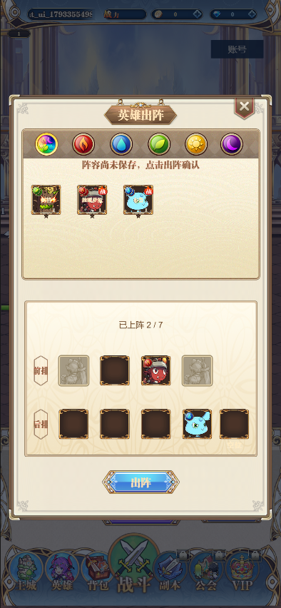
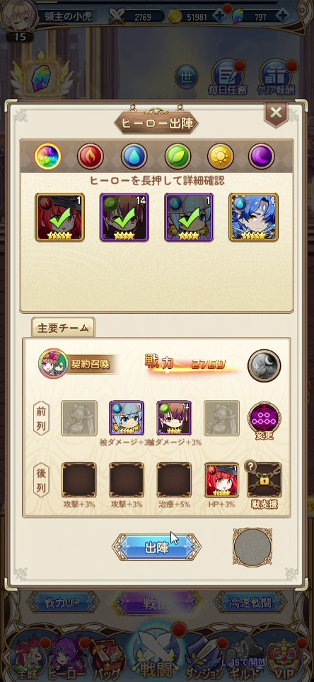
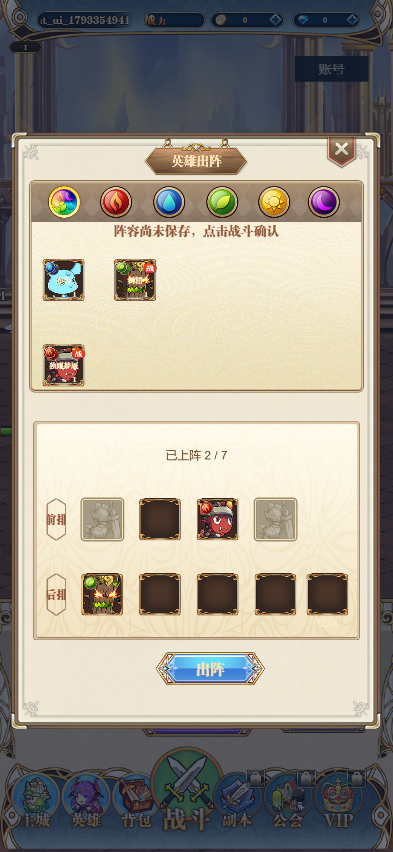

# 出阵页：人工维护入口与验收

本批范围仅为 HeroSelectLayer、必要 Cell/阵位组件和稳定 H5 验收。代码检查、实际运行与用户亲手修改体验分开记录；**人工体验待用户验收**。本批不扩展养成、召唤、活动和完整技能。

## 从哪里打开与修改

1. 在 Creator 资源面板双击 `assets/prefabs/ui/hero/HeroSelectLayer.prefab`，进入 Prefab 编辑模式。准确磁盘路径是 `F:\project\mxzg\client\assets\prefabs\ui\hero\HeroSelectLayer.prefab`。
2. 编辑源 Prefab，Ctrl+S 保存并等待导入完成；退出 Prefab 编辑模式，打开 `assets/scenes/Remake.scene` 预览。不要把运行时节点或临时 Scene 的修改误当成已保存的源资源。
3. 启动新后端，登录后点底栏“战斗”进入挂机，再点页面内“战斗”打开出阵。有上次未领取结算时先领取。可用独立开发账号 `ui_review_1` 验收，不需要清库或修改其他角色。
4. 独立 H5 使用 `scripts/build-remake-h5.bat` 重建后，打开 `scripts/start-remake-h5.bat` 或 `http://127.0.0.1:18081/`。仅刷新旧 H5 不会编译源 Prefab；运行已构建的 H5 不需要 Creator 窗口。

最新要求是**日常优先本机 Creator，H5 证明能通即可**。已按要求停止最终默认布局 H5 构建；当前 18081 保留已验证的临时两列布局包，源 Prefab 和本机预览为默认五列。不要将两者差异误判为本机保存失败，也不要将被取消的构建当成默认包已发布。

Creator 外部修改的脚本要等编辑器导入/编译完成再刷新预览。本批曾遇到 7456 仍运行旧脚本；用户完成导入刷新后，技术检查继续通过。不能把旧预览当作当前代码的结果。

## 节点与资源定位

以下节点路径均相对 `HeroSelectLayer` 根节点：

- 标题：`node_title/lbl_title`，编辑 Label 字体资源、字号、颜色、行高和 UITransform。`FormationView.titleLabel` 指向它，运行时不再改标题文字或样式。
- 确认按钮：`UIMenu_2/btn_confirm`。按钮本身的 Position/Scale/UITransform/Sprite/Button 在这里改；文字在其子节点 `Label`，当前为“出阵”。`FormationView.confirmButton` 只控制可点击状态。
- 关闭按钮：`UIMenu_2/btn_close`，绑定 `closeButton`。
- 英雄列表：`scroll_view_backpack` 上是 ScrollView；`view` 上是矩形 Mask；`view/content` 是滚动内容；`view/content/FormGrid` 是动态 Cell 容器。ScrollView.content 已在 Prefab 绑定，不在打开时补组件或重挂父子节点。
- 元素筛选：`UIMenu_1/btn_elem0` 到 `btn_elem5`；选中框为同级 `spr_select`。代码只按当前选择移动选中框。
- 提示：根下 `UILabelTTF_1`，绑定 `tipLabel`。字号/尺寸/颜色在 Prefab，文字由 Controller 的加载、草稿和错误状态更新。
- 阵容数量：`node_pannel_2/lbl_battle_count`，绑定 `countLabel`。样式在 Prefab，文字动态显示已上阵人数。
- 九个阵位：`node_pannel_2/node_icon_1` 到 `node_icon_9`。各有 `FormationSlotView`，Inspector 的 `position` 为服务端站位编号，`button/portrait/lock/caption` 显式绑定。调整节点位置不会改变站位身份；不要为换外观而修改编号或制造重复编号。
- 列表 Cell：[HeroIconCell.prefab](../client/assets/prefabs/ui/hero/HeroIconCell.prefab)，磁盘路径 `F:\project\mxzg\client\assets\prefabs\ui\hero\HeroIconCell.prefab`。脸为 `spr_face`，名字为 `lbl_name`，元素为 `spr_elem`；`Stars/star0..4` 的横排由标准 Layout 控制，间距在该 Layout.spacingX 改。等级、锁与出战标分别绑定 `levelLabel/lock/battle`。
- 遮罩：根下 `Backdrop`。颜色、Sprite 和 Button 已保存；位置/尺寸由屏幕适配控制。背景 `spr_bg` 上的 BlockInputEvents 防止点面板空白穿透到底下页面。

英雄头像仍由 `HeroCatalog` 根据 `herotype/item` 数据映射到 `resources/ui/hero/hero-icon_*` 并按需加载；没有把全部英雄图片改成直接引用。Cell 及本页自身仍通过功能资源作用域加载。共享 Cell 的现有 UUID 保留，其他英雄页也有回归检查。

## 三种常见修改

**改按钮位置**：选择 `UIMenu_2/btn_confirm`，直接修改节点 Position。交付默认本地坐标为 `(320, 84)`。View 不恢复这个位置；关闭、重开、切页后仍读取源 Prefab。坐标是设计空间单位，不是手机物理像素。

**改标题字体**：选择 `node_title/lbl_title` 的 Label。交付默认字号 56，节点自身 Scale 为 0.5，最终屏幕大小还乘弹窗适配比例。可修改 Font/Use System Font/Font Size/Color；需要固定文字框时保留 Overflow=CLAMP，按需调整 UITransform，而不是在 View 中写 setContentSize。标题文字也直接在 Label.String 改。

**改列表间距**：选择根节点的 FormationView，在 Inspector 改 `columns`（列数）、`cellStep`（列距/行距）、`firstCellPosition`（首格中心）和 `cellScale`（缩放乘子）。默认是 5 列、`112×130`、`(60,-65)`、0.85。FormGrid 本身的位置由 Prefab 保存，可以整体移动；不要用 Content 的滚动位置来代替列表间距。

`cellScale` 乘在 Cell Prefab 原有缩放上，保留 Cell 的原始设计。Cell 内部的图片、文字、尺寸在 Cell Prefab 修改；如果 Sprite 尺寸要由 UITransform 决定，使用 Sprite.SizeMode=CUSTOM。星的可见数量由数据控制，排列由 Stars 上可见的 Layout 控制。

## 哪些属性由代码控制

- `FormationView.fit()` 是本页唯一屏幕适配函数。它读取根 UITransform 的设计尺寸/锚点以及 Inspector 的 `maxWidthRatio/maxHeightRatio`（默认 0.94/0.80），只写根节点 Position/Scale 和 Backdrop 的 Position/尺寸。不要把根 Position/Scale 当作固定按钮位置来改；改静态子节点或上述适配参数。
- 动态 Cell 的 Position 来自首格与列/行距；Scale 是 Prefab 原始缩放乘 `cellScale`。Content 高度按行数更新，底部留白来自 `contentPaddingBottom`，不重写 Content 宽度、锚点或 Grid 位置。
- ScrollView 自身负责滚动 Content 的 Position 和边界收敛；筛选切换会回到顶部。这是显式滚动行为，不是布局复原。移动整个列表请改 `scroll_view_backpack`，修改列表内容起点请用上述 Inspector 参数。
- 动态文字：提示、人数、英雄名、等级、阵位说明；动态状态：锁、上阵标、星数、按钮可点击、头像与元素资源。它们的静态字体、尺寸和图片承载节点不由 View 重建。
- 元素按钮保留 Prefab 中的 Button 过渡动画；本批不另加打开/关闭坐标动画。不存在重开后把按钮移回旧位置的动画代码。
- 原契约/阵法/助阵等未接入节点在 Prefab 中显式 inactive，不再由 `onOpen` 的隐藏清单强制关闭。不要仅打开这些节点就认为业务已接入。

## 代码与协议入口

- 页面 View：[FormationView.ts](../client/assets/scripts/features/hero/ui/FormationView.ts)。打开时校验绑定，渲染数据/列表和集中适配，不请求接口、不决定战斗规则。
- 阵位表现组件：[FormationSlotView.ts](../client/assets/scripts/features/hero/ui/FormationSlotView.ts)。九个实例各绑定自己的编号、按钮、头像、锁和说明；只处理展示，没有新 Manager 或基类。
- Cell：[HeroIconCellView.ts](../client/assets/scripts/features/hero/ui/HeroIconCellView.ts)。只刷数据和点击；不补 Button，不改字体/坐标；缺字段报告具体 Prefab 和字段。
- 业务：[FormationController.ts](../client/assets/scripts/features/hero/FormationController.ts)。查询真实名册/阵容，维护未保存草稿；取消丢弃草稿，确认 PUT 后才返回成功；空阵容、重复点击、换号/关闭及 409 版本冲突保持原有处理。
- 阵容接口：[LineupApi.ts](../client/assets/scripts/features/hero/LineupApi.ts)。`GET /api/v1/lineups/main` 返回 `{version,slots}`；`PUT` 发送 `{expectedVersion,slots}`，slot 为 `{position,heroId}`，heroId 是实例 UUID。当前七个合法位置为 2/3/5/6/7/8/9。
- 名册：[HeroApi.ts](../client/assets/scripts/features/hero/HeroApi.ts)；本地名称/头像投影：[HeroCatalog.ts](../client/assets/scripts/features/hero/HeroCatalog.ts)。协议说明见 [英雄与阵容契约](hero-lineup-contract.md)。当前类型/请求仍是手写实现，不宣称已建立接口自动生成。
- 装配：`app/remake/RemakeApp.ts` 中的 `remake-formation` 注册；进入战斗由 `CampaignController` 在出阵确认成功后继续。没有另建平行的登录/阵容状态。

## 技术验证与用户验收分开

技术探针只模拟源 Prefab 的 Inspector 保存，不代替人的编辑体验：临时字号 44、按钮 `(344,96)`、2 列及 `124×148` 间距；检查运行值、取消后重开、草稿不落库、保存进入战斗。完成后恢复默认参数。探针恢复只撤销自己的字段，遇到并发人工修改时保留它们。

可重复工具是 `node client/tools/formation-authoring-probe.cjs apply|restore|capture`。`capture` 不改源文件，仅记录当前参数和 SHA。实际浏览器检查可通过 `MXZG_FORMATION_EXPECT` 读取这些参数；H5 构建记录本页、Cell、View、阵位组件的输入 SHA，避免用旧产物冒充新结果。具体版本、日志和结果更新在 [开发进度](development-progress.md)。

交付后请用户亲手完成以下体验验收；在收到确认前保持待验收：

1. 自选一个按钮位置和标题字号，Ctrl+S，预览中查看。
2. 改列表列距/行距，查看动态格子；取消、重开，再切页返回，确认没有复原旧布局。
3. 本批 H5 源布局修改→重建→实际运行已由技术探针证明；按最新要求不强制用户现在重复构建。以后需要验收 H5 修改时再重建，单纯刷新旧包不会编译源文件。
4. 确认节点和字段是否容易找到、错误是否能定位、指南是否足够。自动化通过不代表这些体验已由用户接受。

## 正式服对照与截图

依据为用户提供的 `F:\效果\夢境 - Google Chrome 2026-10-30 14-15-35.mp4`，出阵在约 34.3 秒；不声称本批重新完整游玩了正式服。

交付截图是本机 Creator 预览的实际游戏 Canvas（393×852），通过引擎公开 API 关闭性能统计后直接截取。画面是在新开发账号撤下一名英雄后的未保存草稿，因此显示“已上阵 2 / 7”；并非修改截图或伪造服务端英雄。正式服视频画面为 444×965，两者账号、语言、视口不同。

本机默认布局：

正式服视频参考帧：

源 Prefab 临时改成两列后的独立 H5 技术探针（用于证明维护入口，不是视觉目标或默认布局）：

- 已确认的必要差异：简体中文与本机开发身份。英雄数量/等级/星级取各自真实账号数据，不能为凑正式服四名英雄或战力而伪造。
- 当前布局差异：保留原图框架与当前 640×1034 弹窗设计，尚未逐像素校准；本机列表英雄图标相对偏小，名字/出战标呈现方式、字体字重、留白和弹窗占屏比例仍有差异。下半区未接入内容造成较大留白。Inspector 修改能力不等于已经达到 1:1。
- 未补齐的交互/数据：正式服长按英雄详情、契约召唤、战力、阵法、助阵及阵位加成/解锁体系没有在本批补齐。现有七位置政策保留，不宣称完整规则一致；这些是待补缺口，不是默认被接受的永久改版。
- 本批对照只评出阵前景。背景主城 HUD、完整技能和结算界面不在此次重构范围。
- 开发性能统计不是游戏美术。对照截图可用引擎公开 API `System.import('cc').then(cc => cc.profiler.hideStats())` 关闭统计，原始调试截图另存；这不改变 Prefab 布局，也不代表 H5 默认调试包没有统计层。
